# AWS Platform

[English](README.md) | **简体中文**

macOS 原生 AWS 资源与费用浏览工具，支持用户主动发起 S3 文件传输和外部终端 EC2 SSM 连接，基于 SwiftUI 构建。

## 下载

[0.4.0 版本](https://github.com/maydaychen/aws-platform/releases/tag/v0.4.0) 需要 **macOS 13 或更高版本**，请按 Mac 的芯片选择安装包：

| Mac | 安装包 | 压缩包 |
| --- | --- | --- |
| Apple Silicon（M 系列，`arm64`） | [DMG](https://github.com/maydaychen/aws-platform/releases/download/v0.4.0/AWSPlatform-0.4.0-arm64.dmg) | [ZIP](https://github.com/maydaychen/aws-platform/releases/download/v0.4.0/AWSPlatform-0.4.0-arm64.zip) |
| Intel（`x86_64`） | [DMG](https://github.com/maydaychen/aws-platform/releases/download/v0.4.0/AWSPlatform-0.4.0-x86_64.dmg) | [ZIP](https://github.com/maydaychen/aws-platform/releases/download/v0.4.0/AWSPlatform-0.4.0-x86_64.zip) |

打开 DMG 后将 AWSPlatform 拖入 Applications，或解压 ZIP。两个版本均已完成 Developer ID 签名和 Apple 公证；Release 附有 [SHA-256 校验文件](https://github.com/maydaychen/aws-platform/releases/download/v0.4.0/SHA256SUMS.txt) 。SSO 登录需要 AWS CLI v2，配置要求见 [前置条件](#前置条件) 。

## 功能

- **EC2 实例浏览** - 查看实例状态、网络、AMI 和标签；通过详情页「连接」按钮在外部终端打开 SSM 会话
- **EC2 资源分组** - 可折叠的实例、Auto Scaling 组、EBS 卷、快照、负载均衡、目标组和安全组入口；浏览当前账号的 EBS 卷及自有快照，支持搜索、状态筛选、收藏和最近访问
- **Lambda 函数浏览** - 查看函数配置和部署包源码
- **指标与日志** - 手动查询 EC2／Lambda／RDS 的 CloudWatch 指标和当前 Lambda 函数日志，支持时间范围、日志过滤与继续加载
- **S3 存储桶浏览** - 查看 Bucket 安全设置、对象和目录，支持可点击面包屑与按需分页；查看对象历史版本及删除标记；支持单文件上传／下载、进度与取消
- **CloudWatch** - 可折叠的 CloudWatch 分组包含告警与日志入口，查看当前 Region 的 Metric／Composite Alarm、日志组与日志流，手动逐页查询日志事件
- **SNS Topic 浏览** - 查看 Standard／FIFO Topic、属性、策略、标签和订阅，订阅 Endpoint 默认遮罩
- **CodeCommit 查询** - 查看仓库、分支及分支头提交；手动浏览固定提交 SHA 的文件、变更路径及前后内容预览、合并请求
- **RDS 查询** - 浏览数据库实例、集群、元数据及成员；手动查询适用指标、近 14 天数据库事件和自有快照
- **EC2 Auto Scaling 查询** - 查看实例组、容量、成员、策略及活动；手动查询引用的启动模板版本和实例刷新记录，支持成员跳转 EC2
- **Route 53** - 查看当前账号的公有／私有 Hosted Zones、DNS 记录、委派 NS、VPC 关联和标签
- **负载均衡** - 查看 ALB、NLB、GWLB、监听器、ALB 规则、Target Groups 和目标健康状态，支持关联资源跳转及 EC2 手动反查注册目标组
- **安全组** - 浏览当前 Profile／Region 可见的安全组、所属账号、VPC、标签及入站／出站规则
- **资源关联** - 逐层查看 Route 53 记录、负载均衡、目标组、EC2 和安全组的配置关系，支持手动反查及精确跳转
- **AWS Health 事件** - 通过当前 Profile 切换当前账号／整个组织的跨区域事件，支持账号筛选、事件说明和受影响资源
- **Session 与 Profile 分开选择** - 按 session 登录，再手动选择关联的 Profile 和 Region；未选 Profile 时资源区域保持空白
- **按需加载资源** - Profile 验证通过后只加载当前可见模块，EC2／Lambda／S3 也在选中时才查询；同一范围内返回页面复用结果。空列表、失败或取消后可手动刷新，不因反复切页自动重试；切换 Profile 或 Region 清空此前的区域资源结果
- **Profile 搜索** - 在所选 session 内按 Profile 名称、账号 ID 和角色查找
- **SSO 登录** - 应用内点击 `SSO Login`，由浏览器完成 session 授权；也支持复用终端登录缓存
- **费用面板** - 按当前 Profile 账号查看本月／上月费用、日趋势与服务明细，支持独立日期／费用 Region 筛选、内存缓存和手动刷新
- **资源收藏** - 本地保存 EC2 实例、Auto Scaling 组、EBS 卷／快照、Lambda 函数、S3 Bucket、CloudWatch Alarm、SNS Topic、CodeCommit 仓库、RDS 数据库、Route 53 Hosted Zone、负载均衡器、Target Group 和安全组，在当前 Profile 内重新打开，区域型资源恢复保存的 Region
- **最近访问** - 查看并重新打开当前 Profile／账号最近浏览的资源，支持本地历史、搜索和按范围删除
- **界面语言**：跟随系统，或选择简体中文／English；即时切换，不重新加载 AWS 数据
- **原生桌面布局** - 顶部 Session／Profile／区域栏填满窗口宽度，Profile 吸收剩余空间，空间不足时区域组自动换行；区域并列显示地点与代码，工作区／服务侧栏统一滚动，EC2 概览字段对齐，界面跟随系统深浅色

应用不提供资源创建、修改、删除或 Lambda 调用能力。

只读查询仍可能产生 AWS 费用。[AWS 查询费用说明](docs/aws-query-costs.md) 区分 CloudWatch 指标、S3 LIST、CodeCommit 访问，以及普通日志读取与 Logs Insights 的计费边界。

以下是使用模拟资源渲染的应用组件示例：

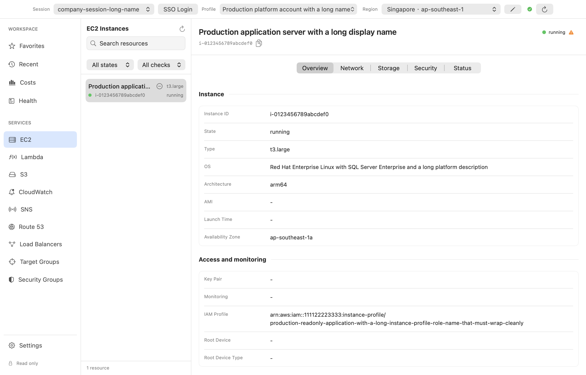

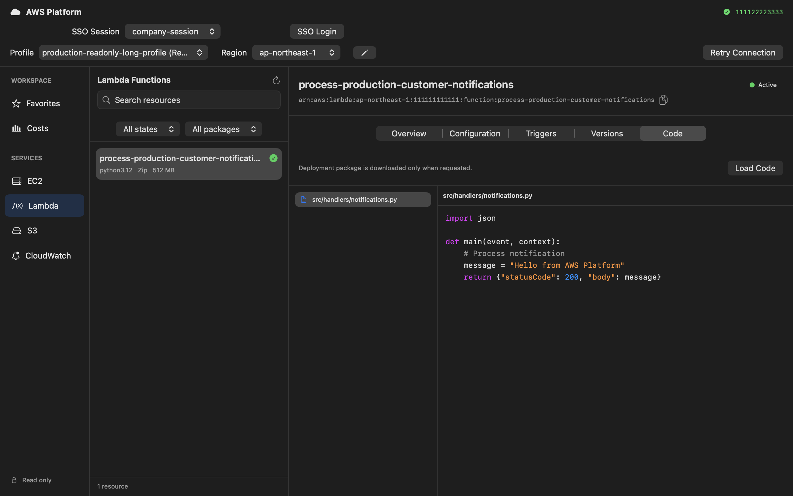

以下顶部栏预览使用模拟 Profile，分别展示宽窗口与窄窗口布局：

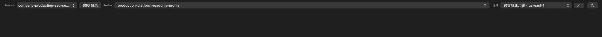

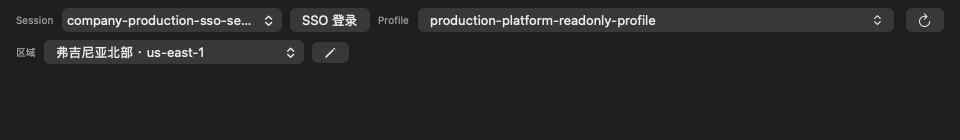

## 技术栈

- Swift 6.2+ / SwiftUI（源码构建工具链）
- macOS 13+，支持 Intel（x86_64）和 Apple Silicon（arm64）
- [Soto](https://github.com/soto-project/soto) - AWS SDK for Swift
- [Sparkle 2](https://sparkle-project.org/) - 签名校验的应用更新

## 快速开始

### 前置条件

- 应用运行需要 macOS 13.0+
- 源码构建需要提供 Swift 6.2+ 的完整 Xcode；构建机器的 macOS 版本需满足所用 Xcode 的系统要求
- 已配置 AWS CLI (`~/.aws/config` 和 `~/.aws/credentials`)
- 使用 SSO 时，先配置具名 `sso-session` 并安装 AWS CLI v2；可在应用内点击 `SSO Login` 或在终端执行 `aws sso login --sso-session <name>`。浏览资源还需配置引用该 session 的 Profile
- 包含 `role_arn` 的 AssumeRole Profile 也需要 AWS CLI v2。目标角色与 `source_profile` 可仅在 config 中声明，credentials 只保存源 Profile 凭据；应用通过有界内存管道导出临时凭据并验证目标账号与角色，不写入凭据或补写重复配置节

Apple Silicon 上应使用能原生运行的 AWS CLI。AWS CLI v2 从 2.30.0 起提供同时支持 Intel／Apple Silicon 的 [官方 Universal 安装包](https://aws.amazon.com/blogs/devops/introducing-universal-installers-for-aws-cli-v2-on-macos/)；旧版 Intel CLI 在没有 Rosetta 的机器上无法启动。

### 构建运行

```bash
# 克隆仓库
git clone https://github.com/maydaychen/aws-platform.git
cd aws-platform

# 构建
swift build

# 运行
swift run

# 测试
swift test
```

### Xcode

```bash
open Package.swift
```

在 Xcode 中直接 Cmd+R 运行。

项目清单声明 Swift tools 5.9，但 `Package.resolved` 当前锁定的部分依赖要求 Swift 6.2+；请以此工具链要求构建。

### 打包通用应用

选择提供 Swift 6.2+ 的完整 Xcode 工具链后，在项目根目录执行：

```bash
./scripts/build-universal.sh
```

脚本使用 `Package.resolved` 锁定的依赖，分别构建 Intel 和 Apple Silicon 的 Release 版本，再合并为 Universal 应用。输出：

- `dist/AWSPlatform.app`：适用于 macOS 13 及以上的两种芯片，可复制到「应用程序」目录。
- `dist/AWSPlatform-universal.zip`：包含上述应用的压缩包。

应用包内置 `Assets/AppIcon/AppIcon.icns` 云端资源图标；修改 PNG 主图并重新生成 macOS 图标尺寸的方法见 [App Icon 说明](Assets/AppIcon/README.md) 。

上述本地包使用 ad-hoc 签名。两个打包脚本均支持 `--architecture arm64`（Apple Silicon）、`--architecture x86_64`（Intel）和 `--architecture universal`（默认，两种架构）。单架构包的主程序和内嵌 Swift 运行库只包含目标架构；保留多个本地包时请使用不同的 `--output-dir`。可通过 `--version` 和 `--build-number` 指定版本与构建号。

正式分发入口为 `scripts/package-distribution.py`，使用相同的架构／版本参数、本机 Developer ID Application 签名、Apple 公证和票据附加，输出以 `AWSPlatform-<版本>-<架构>` 命名的 ZIP、DMG、校验值及公证记录；需要有效签名身份和已配置的 `asc` 认证，详见 [正式打包说明](scripts/README.md#正式签名与公证)。普通 `swift build` 仍只构建当前机器架构。

### 应用更新

`v0.3.1` 及更新版本的安装包提供「AWSPlatform → 检查更新…」菜单和设置中的「更新」分组。自动检查默认关闭；开启后只检查新版本，不自动下载或安装。安装需要确认，并等待应用各窗口中的 S3 任务实际退出，包括已经请求取消的任务；等待重启期间暂停新传输。更新前请先关闭另行启动的其他应用实例。

Apple Silicon 与 Intel 使用独立 HTTPS 清单，按当前运行的应用架构选择。更新要求 Ed25519 签名的清单，并在解包前校验最终 ZIP，延续现有 Bundle ID 和本地偏好。清单验签失败会停止更新；签名验证内容来源，不保证服务器提供的是最新版本。签名密钥丢失时，需要手动安装经过审查、包含新公钥的版本。`v0.3.0` 及更早版本尚未集成更新器，需要先手动安装 `v0.3.1`，后续才能在应用内升级。签名、打包和清单生成见 [打包说明](scripts/README.md#应用更新与发布清单) 。

### 窗口操作

`Cmd+W` 关闭当前窗口，应用继续运行。全部窗口关闭后，点击 Dock 图标或重新打开应用可恢复窗口；通过「文件 → 新建窗口」（`Cmd+N`）可另开资源窗口。

### 界面语言

侧栏底部显示当前运行应用的版本号和构建号，与设置页读取相同的应用包信息。

点击侧栏底部的「设置」，或按 `Cmd+,`，选择「跟随系统」「简体中文」或「English」。语言偏好保存在本机，立即应用于所有已打开的应用窗口；不支持的系统语言回退为英文。

切换语言会保留当前 Session、Profile、Region、筛选条件、资源选择和已加载结果，不会登录、验证凭据或发送 AWS 请求。服务名、资源名称、ID、ARN、AWS 标签、日志和事件说明保留原文。macOS 原生菜单使用系统语言。

开发者文案与资源打包约定见 [Localization](docs/localization.md) 。

### EC2 状态检查

实例列表主动读取全部已列出实例的状态检查，无需逐台点击。通过当前 Profile 和 Region 读取完整状态分页，对缺项进行一轮有界补查，并保留已成功读取的结果。绿色勾号表示检查通过，橙色三角表示需要关注，橙色问号表示读取失败；悬停提示和列表警告提供原因，刷新可重试。灰色横杠表示检查不适用，运行状态仍单独显示。

### EC2 CPU 积分模式

T 系列实例概览的「计算与容量」区域显示当前 `Standard`／`Unlimited` CPU 积分模式，需要当前 Profile／Region 的 `ec2:DescribeInstanceCreditSpecifications` 读取权限。权限不足、读取失败与响应缺失／未知模式分别提示；其他实例系列不查询或展示该字段。应用只读取模式。参考 [AWS API 文档](https://docs.aws.amazon.com/AWSEC2/latest/APIReference/API_DescribeInstanceCreditSpecifications.html) 。

### EC2 SSM 连接

手动选择并验证 Profile、选择 Region 后，打开运行中的 EC2 实例，点击详情标题区的「连接」（Connect）。应用生成私有一次性 `.command` 脚本，通过系统默认文件关联打开；请将 `.command` 默认打开程序设为终端应用。应用不内置终端或增加终端设置页。会话移交后由外部终端管理，切换 Profile 或关闭 AWSPlatform 不会结束已经移交的会话。

AWS CLI v2 需位于 `/opt/homebrew/bin`、`/usr/local/bin` 或 `/usr/bin`；[Session Manager 插件](https://docs.aws.amazon.com/systems-manager/latest/userguide/install-plugin-macos-overview.html) 需位于 `/opt/homebrew/bin`、`/usr/local/bin` 或 `/usr/local/sessionmanagerplugin/bin`。应用只检查可执行文件是否存在，安装损坏或运行时错误显示在终端中。实例需要正常的 SSM Agent、实例权限及 Systems Manager 网络连通性；当前角色需要相应的 [Session Manager 权限](https://docs.aws.amazon.com/systems-manager/latest/userguide/getting-started-restrict-access-quickstart.html) 。EC2 处于运行状态不代表 SSM 一定可用。

脚本通过当前 Profile 和 AWS 配置路径仅解析一次凭据，核对账号和去除会话后缀的主体 ARN 后，使用同一组内存凭据及所选 Region 发起 SSM；这两次调用不重新解析 Profile 或共享配置。凭据不写入脚本、磁盘、命令行参数、日志或终端历史。登录过期、权限不足、目标离线等错误由 CLI 显示。脚本执行退出或移交失败时清理；若关联程序始终未执行脚本，文件可能留在私有系统临时目录。应用不安装 Agent 或修改 IAM／SSM 配置。参考 [start-session](https://docs.aws.amazon.com/cli/latest/reference/ssm/start-session.html) 。

### EC2 导航、EBS 卷与快照

EC2 侧栏分组包含「实例」「EBS 卷」「快照」「负载均衡器」「目标组」和「安全组」，在本机保存展开偏好。收起分组保留当前页面，并在 EC2 下显示当前子页面名称；从收藏、最近访问或关联资源进入时展开对应入口。现有 EC2 收藏与启动服务偏好的原始标识保持不变。

手动选择并验证 Profile 后，EBS 页面读取该 Profile 当前 Region 的资源。卷列表包含已挂载与未挂载的卷；详情显示 API 返回的容量、类型、状态、加密、KMS Key、来源快照、挂载信息和标签。快照请求固定使用 `OwnerIds=self`，只显示当前账号拥有的快照，包含归档快照；详情展示来源卷、进度、存储层级、描述和标签，不包含共享或公共快照。两个列表均支持完整分页、本地搜索与状态筛选、手动刷新／取消、收藏和最近访问。切换范围清空旧数据，刷新失败时保留的历史列表会明确标记为可能过时。

需要 `ec2:DescribeVolumes`、`ec2:DescribeSnapshots` 读取权限；权限不足、凭据过期、网络和分页不完整分别提示。应用不创建、挂载、卸载、恢复、修改、共享或删除卷及快照。参考 [DescribeVolumes](https://docs.aws.amazon.com/AWSEC2/latest/APIReference/API_DescribeVolumes.html) 和 [DescribeSnapshots](https://docs.aws.amazon.com/AWSEC2/latest/APIReference/API_DescribeSnapshots.html) 。

### CodeCommit 查询

手动选择并验证 Profile、选择 Region 后，打开侧栏的 CodeCommit。仓库列表完整读取分页，支持按名称／ID 本地搜索、刷新和取消。选择仓库后，元数据和分支独立加载，某一部分权限不足时仍可查看另一部分。只有元数据返回默认分支且该分支存在于列表中时才自动选中；空仓库不会触发提交查询。

概览包含仓库元数据、克隆地址，以及所选分支最近查询的头提交 SHA、说明、作者、提交者、原始 Git 时间戳和父提交 SHA。手动刷新分支头可检查更新。仓库支持收藏和最近访问，使用已验证 Profile／账号／Region 内的仓库 UUID 定位。

在「源码文件」输入完整的 40 字符提交 SHA 和仓库目录路径，再加载目录并选择文件。预览绑定固定提交，上限为 512 KiB 和 5,000 行；二进制或非 UTF-8 内容不预览。「提交差异」手动比较固定的前后提交 SHA，列出新增、删除或修改的路径，并分别预览变更前后的内容，不提供逐行 diff；变更前 SHA 留空时列出变更后提交中的全部文件。「合并请求」加载未关闭、已关闭或全部请求 ID，点击 ID 查看元数据、描述、源／目标引用及提交。仓库内容不执行，也不保存为本地文件。切换范围或仓库时使旧内容请求失效；各项查询手动触发，不轮询。

需要 `codecommit:ListRepositories` 对 `"*"` 的权限，以及允许仓库上的 `codecommit:GetRepository`、`codecommit:ListBranches`、`codecommit:GetBranch`、`codecommit:GetCommit`、`codecommit:GetFolder`、`codecommit:GetFile`、`codecommit:GetDifferences`、`codecommit:ListPullRequests` 和 `codecommit:GetPullRequest`；加密仓库还取决于相应 KMS Key 的权限与状态。CodeCommit 保持只读，不执行 clone／push、文件编辑或合并请求创建／合并。访问仓库可能产生活跃用户、请求或 KMS 费用，见 [AWS 查询费用说明](docs/aws-query-costs.md) 与 [AWS CodeCommit 权限表](https://docs.aws.amazon.com/codecommit/latest/userguide/auth-and-access-control-permissions-reference.html) 。

### RDS 查询

手动选择并验证 Profile、选择 Region 后，打开侧栏的 RDS。数据库实例和集群独立完整分页加载，一类查询失败时仍可查看另一类结果；可按标识符、ARN、引擎和端点本地搜索，或按资源类型筛选。选择数据库后查看返回的元数据；刷新重新加载两类列表，取消保留已经完成的结果。切换范围时清空旧数据并丢弃迟到响应。实例和集群支持按 ARN 收藏和最近访问。

概览使用 `rds:DescribeDBInstances` 和 `rds:DescribeDBClusters` 及其返回的标签，排除共享集群、Neptune 和 DocumentDB。详情包含接口返回的引擎／版本／状态、实例规格、端点／端口、可用区、子网组／安全组、存储／加密、备份保留、删除保护、集群成员及 Serverless v2 容量。实例响应可含 VPC／子网 ID；集群只返回子网组名称，不包含 VPC／子网明细。缺失字段保持未知，不能仅根据 `engineMode=provisioned` 排除 Serverless v2。

详情页签仅在手动操作后查询。「指标」读取实例 CPU 使用率、连接数、可用内存、读写延迟，以及非 Aurora 实例的剩余存储空间。Aurora 集群显示存储卷已用字节数及读写 I/O 次数；CPU、内存和连接数需要查看成员实例。其他集群（包括 Multi-AZ 数据库集群）引导查看成员实例指标。「事件」读取所选实例或集群近 14 天的记录。「快照」列出当前账号拥有、属于所选数据库的自动／手动快照，排除共享／公共快照；查看列表不会创建备份，也不代表已验证恢复可用性。

这些页签另需 `cloudwatch:GetMetricData`、`rds:DescribeEvents`，以及适用的 `rds:DescribeDBSnapshots` 或 `rds:DescribeDBClusterSnapshots`。指标查询可能产生费用，见 [AWS 查询费用说明](docs/aws-query-costs.md) 。应用不连接数据库、执行 SQL、启用监控／日志导出、创建／恢复快照或修改 RDS 资源。参考 [DescribeDBInstances](https://docs.aws.amazon.com/AmazonRDS/latest/APIReference/API_DescribeDBInstances.html) 、[DescribeDBClusters](https://docs.aws.amazon.com/AmazonRDS/latest/APIReference/API_DescribeDBClusters.html) 和 [RDS IAM 动作表](https://docs.aws.amazon.com/service-authorization/latest/reference/list_rds.html) 。

### EC2 Auto Scaling 查询

手动选择并验证 Profile、选择 Region 后，打开「EC2 → Auto Scaling」。组列表完整分页，支持本地搜索、刷新和取消，不自动选择实例组。详情包含容量数值与类型、普通成员数、可用区／子网、启动配置／模板及混合实例摘要、健康检查、暂停进程、负载均衡关联、成员和标签。容量可能按权重、vCPU 或内存单位计量，不直接视为实例台数；缺失字段保持未知，启动模板保留 `$Latest` 等别名，组操作状态不解释为健康状态。

选择组后独立加载扩缩容策略摘要和近六周活动，详情刷新按钮只重新读取这两部分，组元数据通过列表刷新重读；一类失败不影响另一类结果。可手动加载组内引用的启动模板版本，包括混合实例／override 引用，保留 `$Latest`、`$Default` 等别名的原意；显示接口返回的配置字段，不解析 SSM AMI 别名，也不展示 UserData。另可手动加载近六周的实例刷新记录，未知开始时间的记录仍保留，不轮询，也不发起或取消实例刷新。成员链接在同一已验证范围内打开精确的 EC2 实例。组支持按 ARN 收藏和最近访问。

切换 Profile、身份、Region 或实例组后丢弃旧响应。不查询 Warm Pool 成员、ASG 指标或完整高级指标／预测策略配置，不修改容量或执行扩缩容动作。需要 `autoscaling:DescribeAutoScalingGroups`、`autoscaling:DescribePolicies` 和 `autoscaling:DescribeScalingActivities` 对 `"*"` 的权限；新增详情另需 `ec2:DescribeLaunchTemplateVersions` 和 `autoscaling:DescribeInstanceRefreshes`，成员跳转使用既有 `ec2:DescribeInstances` 读取权限。参考 [DescribeAutoScalingGroups](https://docs.aws.amazon.com/autoscaling/ec2/APIReference/API_DescribeAutoScalingGroups.html) 、[DescribePolicies](https://docs.aws.amazon.com/autoscaling/ec2/APIReference/API_DescribePolicies.html) 、[DescribeScalingActivities](https://docs.aws.amazon.com/autoscaling/ec2/APIReference/API_DescribeScalingActivities.html) 和 [Auto Scaling IAM 动作表](https://docs.aws.amazon.com/service-authorization/latest/reference/list_autoscaling.html) 。

### S3 对象浏览

Bucket 列表完整读取当前账号的所有分页，支持已提高 Bucket 配额的账号，不按当前浏览 Region 筛选；任一页面失败时，不把部分结果展示为完整成功列表。

打开 Bucket 时只加载对象和文件夹的第一页，每次请求最多返回 1,000 项；点击「加载更多」才请求下一页，不再自动遍历整个目录。底部显示已加载数量，搜索只筛选当前目录已加载的项目，不查询尚未加载的页面或子目录。当前页没有可显示项目时，仍可能存在后续页。

点击路径栏的「根目录」或任意祖先目录即可返回，长路径支持横向滚动；前缀中的斜杠、空格、Unicode 与百分号按原样保留。续页失败保留已有列表，可点击「重试」；权限拒绝或 Bucket 不存在时清空旧行。Bucket 浏览、详情和位置查询均限定 Bucket 属于当前已验证账号。刷新以及上传成功后的刷新都会从第一页重新开始，新上传对象可能位于后续页。切换目录、Bucket 或 Profile 时清除旧分页状态并丢弃迟到结果。浏览使用 `s3:ListBucket` 和现有 Bucket 区域查询，LIST 请求可能产生 S3 请求费用。参考 [ListObjectsV2](https://docs.aws.amazon.com/AmazonS3/latest/API/API_ListObjectsV2.html) 。

### S3 对象历史版本

选择对象后，点击工具栏或右键菜单中的「对象历史版本」，再点击「加载版本」。弹框读取此完整 Key 的版本及删除标记，每次手动请求最多 100 项；点击「加载更多」继续，搜索仅覆盖已加载的版本 ID，未读完时明确标记部分列表。版本 ID、最新标记、修改时间、大小、ETag 和存储类别未返回时保持未知。此入口仅查看版本，不下载历史版本、恢复、删除或修改版本控制；不支持目录 Bucket。

查询绑定已验证 Profile／账号、Bucket 实际 Region 和预期所属账号。需要 `s3:ListBucketVersions`，实际区域未知时另需 `s3:GetBucketLocation`。范围、Bucket、前缀或所选对象变化时使旧分页失效。每次 `ListObjectVersions` 分页可能产生 S3 LIST 请求费用，已有版本的存储另行计费，见 [AWS 查询费用说明](docs/aws-query-costs.md) 。

### S3 文件传输

下载覆盖现有本地文件时，通过原子交换将被替换文件保留在同目录的 `AWSPlatform Recovery <UUID>` 路径，完成提示提供可复制的位置；应用不自动删除恢复副本。即使其他程序在最终检查与替换之间保存了编辑，内容也会保留。新目标使用排他提交，提交前失败不会更改原文件；文件系统不支持原子交换时，覆盖会失败。

选择并验证 Profile 后，打开 Bucket 并进入对象列表。「上传文件」选择一个本地文件，使用文件名上传到当前前缀。确认前先准备私有临时副本，上传使用该副本及其 SHA-256 校验和；准备过程需要文件大小加 64 MiB 预留空间。写入前的确认弹窗显示 Profile、账号、Bucket、完整 Key、本地路径和大小；同名对象需要单独确认「覆盖」。新建使用 `If-None-Match: *`，确认覆盖使用当前对象的 ETag 作为 `If-Match`，并发变化会导致上传失败，避免静默替换更新后的对象。上传成功后刷新当前前缀。覆盖不会复制原对象的元数据、标签或 ACL，新对象使用本次上传参数和 Bucket 默认设置；Bucket 现有版本控制、默认加密和策略继续生效，应用不会修改这些配置。

也可从 Finder 拖入一个本地文件到对象列表，空列表同样支持。拖入高亮显示当前 Bucket／前缀；拖到文件夹行上仍上传到正在浏览的目录。松手后直接进入同一上传确认流程，无需再选择文件。暂不支持多文件、文件夹、符号链接或网页链接；有其他传输或确认时禁用拖入。文件地址解析期间切换 Profile 或离开目录，会使这次拖入失效。

通过对象详情按钮或右键菜单下载，再由 macOS 保存窗口选择本地位置。请求使用列表中的 ETag 发起 `If-Match` 条件下载；对象变化或元数据不完整时需要刷新列表。应用检查响应 ETag 和大小，写入不超过确认大小，并保留 64 MiB 磁盘空间。临时文件操作固定在选中的保存目录，目录被替换时保存失败；完整成功后才提交。传输中断或失败会删除临时文件并保留原有本地文件，完成后再取消不能撤销已保存的文件。支持空对象，不下载文件夹；S3 Key 不会作为本地文件系统路径使用。

传输只使用当前已验证 Profile 和 Bucket 实际 Region。切换／清空 Profile、重新验证、切换 Region 或离开 Bucket／前缀时，取消待处理任务并使旧弹窗和结果失效。取消上传不能撤销 AWS 已经接收的写入，需要刷新确认对象。文件按块读写，提供进度和「取消」；单文件上传上限为 5 GiB。每个窗口同时执行一个传输，不自动重试。

上传需要 `s3:PutObject`，下载及覆盖前的 ETag 检查需要 `s3:GetObject`；实际区域未知时，位置查询需要 `s3:GetBucketLocation`。使用 KMS 加密的对象还需要相应密钥权限。参考 [PutObject](https://docs.aws.amazon.com/AmazonS3/latest/API/API_PutObject.html) 、[GetObject](https://docs.aws.amazon.com/AmazonS3/latest/API/API_GetObject.html) 和 [SSE-KMS 权限](https://docs.aws.amazon.com/AmazonS3/latest/userguide/UsingKMSEncryption.html) 。除用户主动发起的外部 EC2 SSM 会话外，其他服务保持只读；没有单独的对象删除、归档恢复、ACL／标签编辑或 Bucket 配置操作。

### 资源收藏

在资源详情顶部点击 `Add Favorite` 收藏，再次点击 `Remove Favorite` 取消。侧栏 `Favorites`（快捷键 `Cmd+Shift+F`）集中展示收藏，可按资源名称、ID、服务、Profile、账号或 Region 搜索；点击条目打开资源，点击星标或使用右键菜单移除收藏。

支持 EC2 实例、Auto Scaling 组、EBS 卷与快照、Lambda 函数、S3 Bucket、CloudWatch 告警、SNS Topic、CodeCommit 仓库、RDS 实例／集群、Route 53 Hosted Zone、负载均衡器、Target Group 和安全组。RDS 与 Auto Scaling 使用 ARN，CodeCommit 使用仓库 UUID 定位。日志组、对象版本、仓库文件／提交／合并请求、RDS 快照不单独保存为收藏目标。

先手动选择 Profile，收藏列表才会显示。打开收藏时，应用要求当前 Profile 与收藏一致，再恢复保存的 Region、校验账号并定位资源；不会通过收藏自动选择其他 Profile。Profile 不一致或缺失、账号不匹配、资源已删除或访问失败时会显示提示，收藏仍会保留。S3 收藏保存的是收藏时的浏览 Region，Bucket 实际位置由现有加载流程另行解析。

收藏通过本机 UserDefaults 保存，重启后恢复，同一应用进程的多个窗口共享收藏列表。保存内容仅包含 Profile 名称、账号 ID、Region、服务、资源 ID 和显示名称；不保存凭据、资源详情或环境变量，不进行云端同步。相同资源在不同 Profile、账号或浏览 Region 下分别保存。

Route 53 Hosted Zone 使用固定的 `global` 范围和规范化 Zone ID；重新打开时保留当前资源 Region，仍重新核验当前 Profile 的账号。

### 最近访问

选择并验证 Profile 后，打开侧栏 `Recent`（`Cmd+Shift+R`），按最近访问时间查看该 Profile 当前账号在各浏览 Region 的资源历史。每个 Profile／账号最多保留 50 条记录，资源类型与收藏相同，包括 EBS 卷／快照、CodeCommit 仓库、RDS 实例／集群和 Auto Scaling 组；按服务、资源 ID 和保存的 Region（Route 53 为 `global`）去重。再次访问会置顶并更新名称、访问时间。只有实际显示详情的资源才记入历史，包括服务页当前可见的默认首项；后台加载但未展示的选择、S3 对象、日志组、单条 DNS 记录、监听器和规则不记录。

支持按名称、资源 ID、服务、Profile、账号或 Region 搜索。点击条目沿用收藏导航，重新核验账号并定位资源；区域型资源恢复保存的 Region，Route 53 保留当前资源 Region。不自动选择其他 Profile，也不增加收藏。资源不存在、账号变化或权限不足会提示并保留记录；可删除单条，或确认 `Clear history` 后仅清空当前 Profile／账号的历史。

历史保存在本机 UserDefaults，重启后恢复，应用各窗口共享存储，各自按已验证的 Profile／账号筛选；没有已验证的选择时不显示历史。仅保存资源定位信息、名称与访问时间，不保存凭据、资源正文或日志。记录、搜索、删除历史不调用 AWS，重新打开资源会执行正常读取请求。存储不可读时保留原始数据，提示并禁用编辑。

以下为使用模拟资源历史渲染的组件示例：

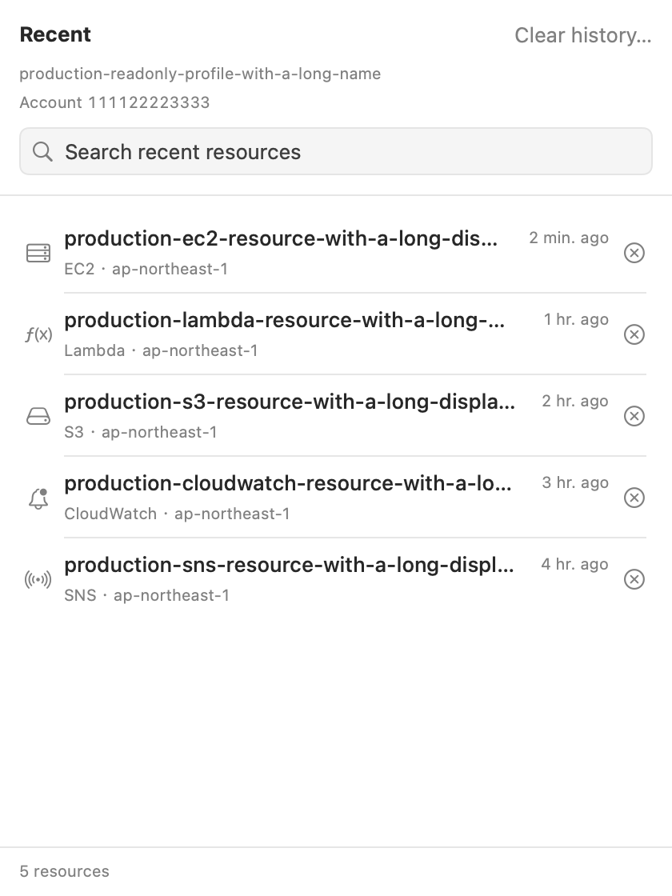

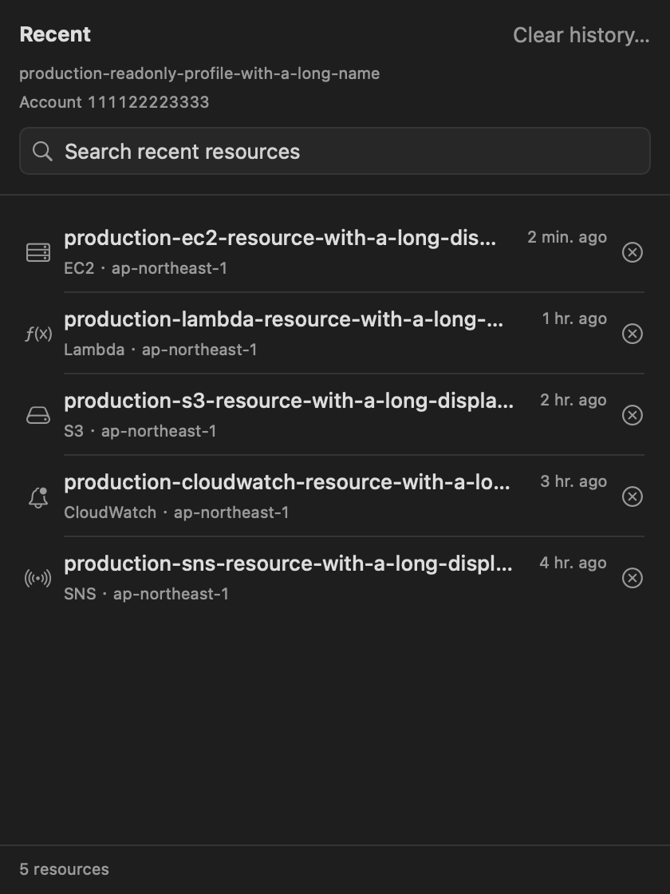

### 安全组与资源关联

打开 `Security Groups`，按安全组 ID、名称、VPC、所属账号、标签或规则内容搜索，并按 VPC 筛选。选中后查看元数据、标签和入站／出站规则，包含协议、端口或 ICMP 类型／代码、CIDR、Prefix List 和安全组引用。列表完整分页，支持刷新／取消，刷新失败时标记保留数据可能过期。查询使用当前 Profile 和 Region，可见共享组的所属账号单独展示；支持收藏及最近访问。

在 EC2、LB、Target Group、安全组或 Hosted Zone 详情点击 `View relationships`；Alias 和 CNAME 记录行也提供单条记录入口。弹框先展示名称和直接关联类型，展开后查看字段，点击 `Explore` 再查下一层，点击 `Open` 打开精确资源。`Back` 恢复之前加载的快照，`Refresh` 重新读取；关闭弹框或切换外层 Profile、Region、资源时清空状态。SNS 保留原有调用链视图。

关系包含 LB 关联目标组、目标组注册的 EC2／Lambda／ALB，以及 EC2／LB 绑定的安全组。安全组之间的引用表示权限规则，不证明网络连通；IP 目标不推断为 EC2。Lambda qualifier 保留展示，`Open` 打开函数级详情。仅能确认属于当前账号的安全组引用可跳转，共享或所属账号未知的目标只展示信息。

Route 53 关联需明确选择 LB 查询 Region。直接 Alias 同时匹配 LB DNS 名和 canonical Hosted Zone ID，CNAME 只匹配直接 DNS 目标；处理大小写、末尾点及 ALB 的 `dualstack.` 形式，不凭域名后缀猜测，也不解析多跳 DNS。加权／故障转移记录保留各自路由标识。未匹配表示当前查询范围未关联，不代表目标不存在。打开匹配的区域资源会明确切换资源 Region 并重新核验当前 Profile 身份；打开全局 Route 53 记录则保留资源 Region，将精确记录置顶展开，其余记录保留在下方。

反向查询仅在点击后执行：EC2 扫描实例型目标组，安全组查询使用它的 EC2（包含附加网卡）和 LB，LB 扫描 Hosted Zones 中直接指向它的 DNS 记录。Zone 记录扫描最多 4 个并发，展示成功／总检查数及失败 Zone，不把部分结果当作“完全没有关联”。不自动查询其他 Profile 或遍历所有 Region。这些都是配置关系，不代表实际流量或 DNS 传播结果。

安全组与实例关系需要 `ec2:DescribeSecurityGroups`、`ec2:DescribeInstances` 和 `Resource: "*"`；ELBv2 与 Route 53 关系复用下文对应读取权限。参考 [EC2 IAM 文档](https://docs.aws.amazon.com/service-authorization/latest/reference/list_ec2.html) 、[安全组规则](https://docs.aws.amazon.com/vpc/latest/userguide/security-group-rules.html) 和 [Route 53 Alias 目标](https://docs.aws.amazon.com/Route53/latest/APIReference/API_AliasTarget.html) 。应用不修改安全组规则或 DNS 记录。

以下组件预览使用模拟数据：

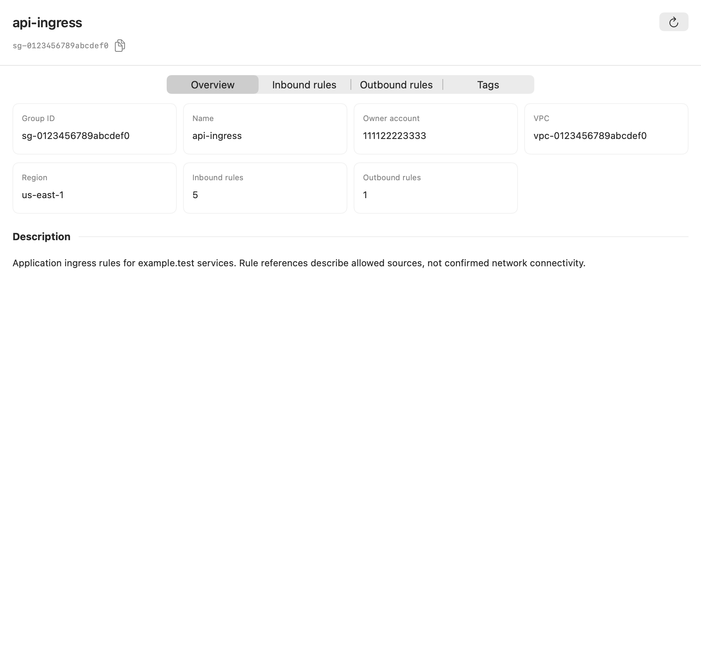

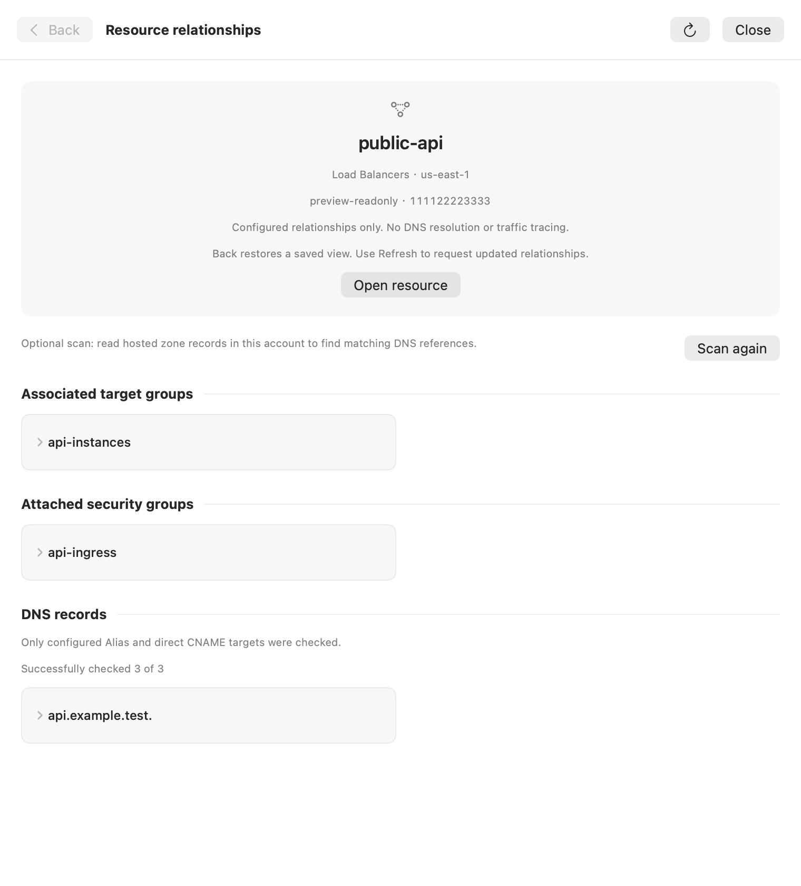

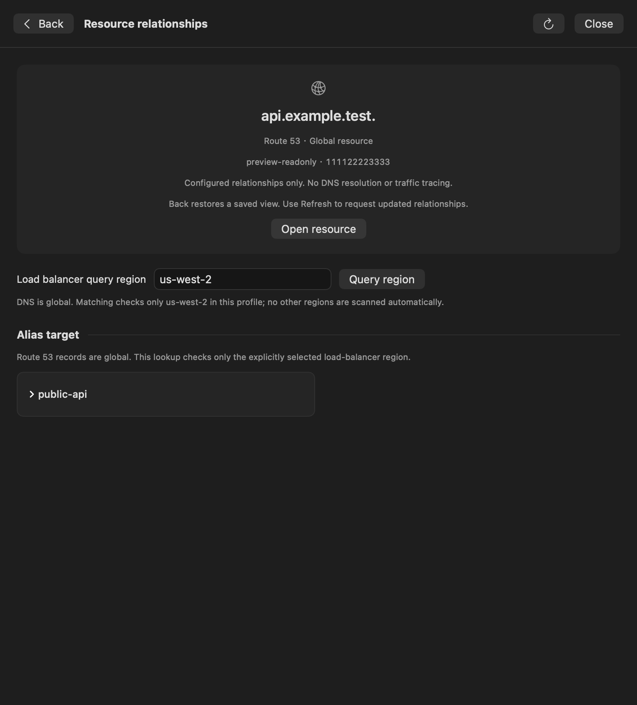

### Load Balancers 与 Target Groups

选择并验证 Profile 和 Region 后，打开侧栏 `Load Balancers` 或 `Target Groups`，查看该账号、该 Region 的 ELBv2 资源，覆盖 Application、Network 和 Gateway Load Balancer。列表支持本地搜索和类型筛选，手动选择资源后加载详情；未选 Profile 时不查询。负载均衡器和目标组按 ARN 与 Region 接入收藏及最近访问。

负载均衡器显示 DNS 名、scheme、状态、网络配置、监听器和关联目标组。监听器显示协议、端口、TLS 配置与默认动作；选择 ALB 监听器后读取规则优先级、条件、变换和按顺序执行的动作。Forward 展示所有加权目标组，重定向、固定响应和认证动作分别呈现。认证密钥和额外认证参数不进入应用模型。这些关联表示配置关系，不是实际流量轨迹。

Target Group 显示协议、目标类型、健康检查配置和关联 LB。注册目标显示端口、可用区、健康状态，以及接口返回的原因与说明。`Open` 仅打开同 Profile／账号／Region 的精确资源：实例目标进入 EC2，Lambda 目标进入函数，ALB 目标进入负载均衡器；IP 目标仅展示，不推断所属 EC2。Lambda 别名／版本保留在目标 ARN 中，链接打开函数级详情，不表示限定版本的调用视图。目标缺失或查询失败时提示，不替换为其他资源。

EC2 详情的 `Target Groups` 页签提供手动查询：列出当前 Region 的目标组，仅对实例类型逐组读取健康状态，最多同时发起 4 个请求，按精确实例 ID 匹配并保留同实例的多个注册端口；排除 `Target.NotRegistered` 结果。界面显示成功检查数量及逐组失败，不把未检查完整的空结果当作“没有关联”。仅点击查询时扫描，不修改主 Target Group 列表或收藏。

列表及关联数据按需读取，完整分页，支持手动刷新和取消，不定时轮询。列表刷新失败时标记保留数据可能过期；监听器、规则和目标健康状态各自显示失败。Profile、账号或 Region 变化会清空旧状态并隔离旧响应；关联跳转始终留在当前范围，不自动选择其他 Profile。

角色需要 `elasticloadbalancing:DescribeLoadBalancers`、`elasticloadbalancing:DescribeTargetGroups`、`elasticloadbalancing:DescribeListeners`、`elasticloadbalancing:DescribeRules` 和 `elasticloadbalancing:DescribeTargetHealth`，使用 `Resource: "*"`。参考 [ELBv2 IAM 文档](https://docs.aws.amazon.com/service-authorization/latest/reference/list_elbv2.html) 、[监听器动作](https://docs.aws.amazon.com/elasticloadbalancing/latest/APIReference/API_Action.html) 和 [目标健康状态](https://docs.aws.amazon.com/elasticloadbalancing/latest/APIReference/API_TargetHealth.html) 。应用只执行读取操作。

以下组件示例使用模拟数据：

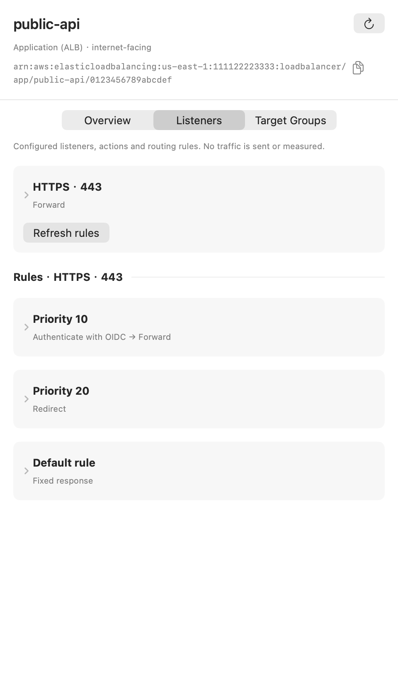

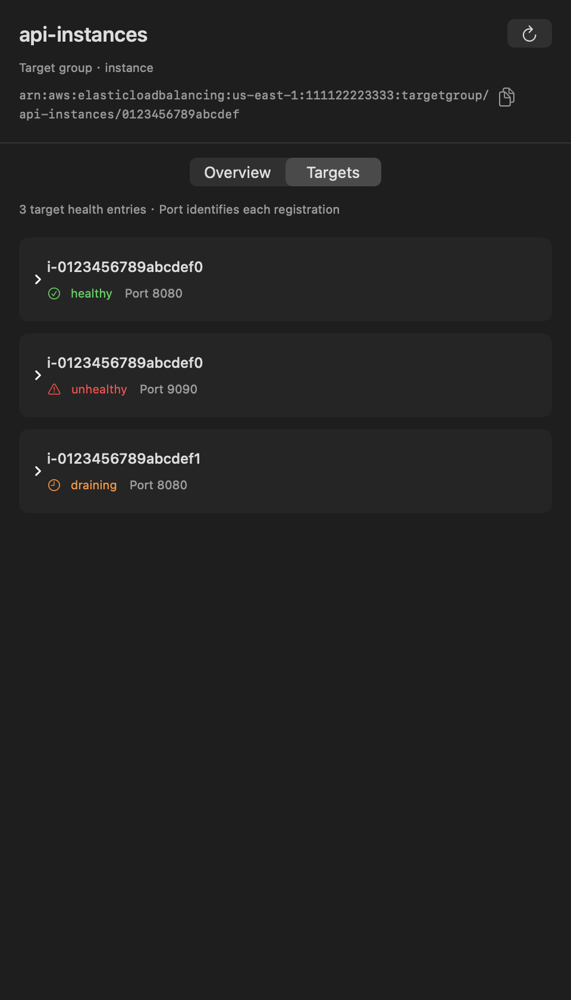

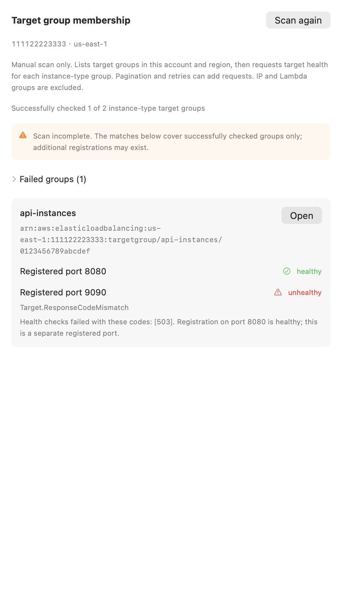

### Route 53

选择并验证 Profile 后，打开侧栏 `Route 53`，查看当前账号的公有和私有 Hosted Zones。Route 53 在该 Profile 所属 AWS 分区内是全局服务，此页隐藏资源 Region 选择器，在其他页面切换资源 Region 不会重查数据；商业区、中国区和 GovCloud 使用 SDK 对应端点。未选择 Profile 时不查询、不显示资源。

按 Zone 名称或 ID 搜索、按公有／私有筛选，选中后查看 `Overview`、`Records` 和 `Tags`。Overview 显示 Zone ID、备注、记录数量、调用者引用、公有 Zone 的委派 NS，以及私有 Zone 返回的 VPC 关联。NS 和 VPC 信息表示 AWS 配置，不是实际 DNS 测试或 VPC 资源清单。托管区元数据、记录与标签独立加载，某一项失败不影响其他内容。

记录支持本地搜索和类型筛选，点击展开原始值、TTL、Alias 目标及目标健康评估、路由标识和适用的加权、延迟、故障转移、地理位置、地理邻近、多值或基于 IP 的路由配置。健康检查与流量策略仅显示标识，不查询对应资源。Alias 可以没有 TTL；TXT 引号、转义等原始值保持不变。这里展示 API 的最新配置，可能包含尚未传播完成的 DNS 变更，不代表传播验证结果。

列表首次进入时加载并完整分页，不定时轮询；可手动 `Refresh` 或 `Cancel`。Zone 列表刷新失败时标记保留数据可能过期，记录分页不完整时不作为完整结果显示。切换 Profile／session、重新登录和重试连接会清空旧状态并隔离旧请求。Hosted Zone 使用 `global` 和 Zone ID 接入收藏与最近访问，重新打开时保留原资源 Region 并重新核验账号；单条 DNS 记录不单独收藏或记录访问历史。

角色需要对 `Resource: "*"` 授予 `route53:ListHostedZones`，并对允许的 Hosted Zone 资源授予 `route53:GetHostedZone`、`route53:ListResourceRecordSets` 和 `route53:ListTagsForResource`。参考 [Route 53 IAM 文档](https://docs.aws.amazon.com/service-authorization/latest/reference/list_route53.html) 、[记录查询 API](https://docs.aws.amazon.com/Route53/latest/APIReference/API_ListResourceRecordSets.html) 和 [服务端点](https://docs.aws.amazon.com/general/latest/gr/r53.html) 。应用不修改 DNS 记录、不注册域名、不执行 Resolver 查询。

以下为使用模拟 Route 53 数据渲染的组件示例：

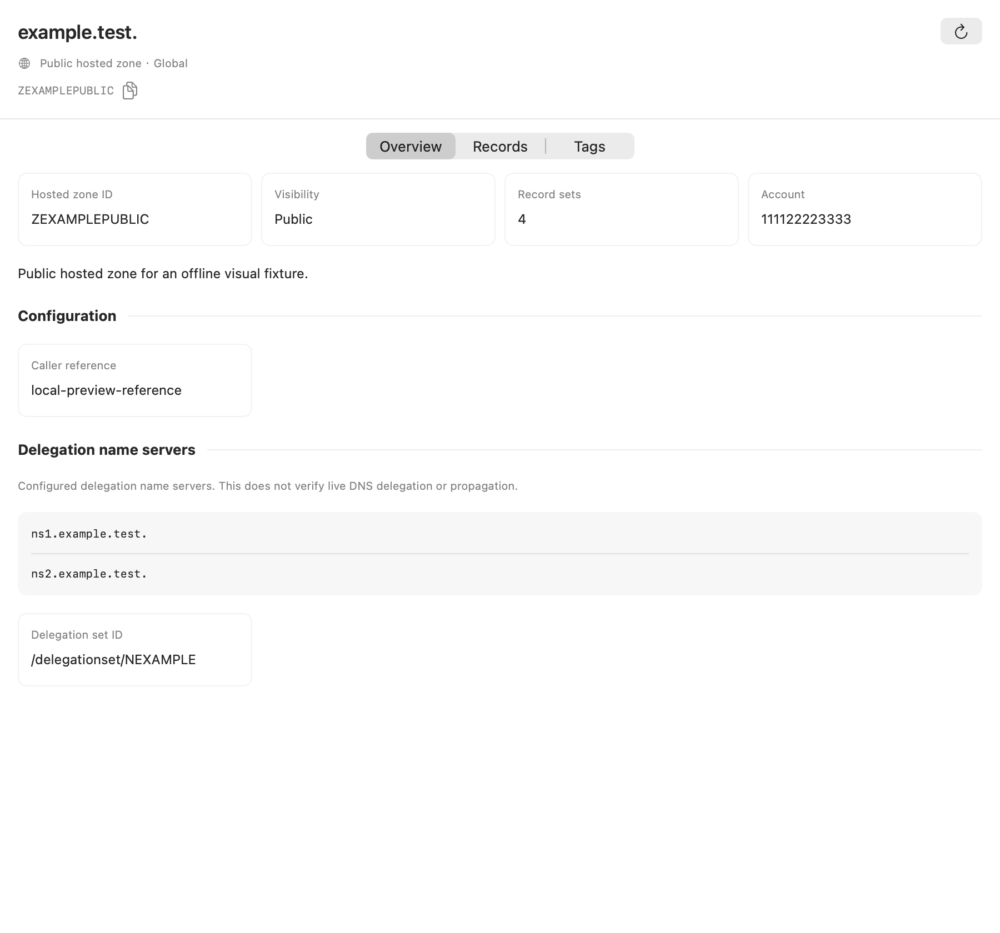

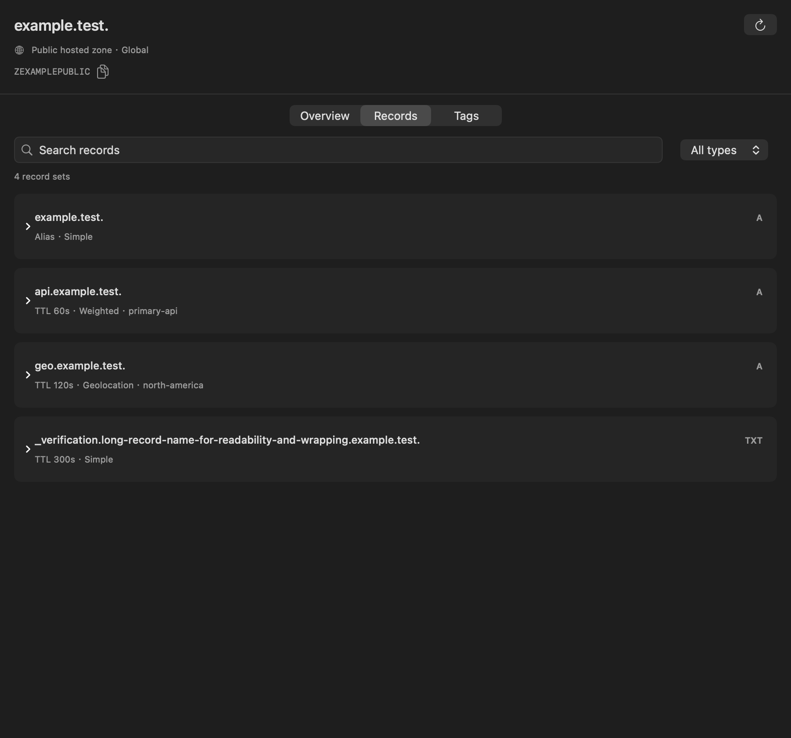

### 费用面板

手动选择并验证 Profile 后，打开侧栏 `Costs`（`Cmd+Shift+B`）首次加载费用。面板提供本月累计、上月整月费用、选定期间的日趋势和按服务明细；使用 `UnblendedCost`，保留 AWS 返回的币种、负数退款及 `Estimated` 状态。无数据与实际零费用分别展示。

每个费用请求都限定为当前 Profile 经 STS 验证的账号，包含 `LINKED_ACCOUNT` 筛选；管理账号也只展示自身账号费用，不自动汇总组织成员。Profile 的角色仍需具备账单访问权限。未选择 Profile 不查询；切换 Profile、session、重新登录或重试连接会清空费用缓存。

日期支持本月、上月、最近 30 天和自定义范围，采用 UTC 完整日，不包含当天未结束的数据；可选当前月及此前 12 个月。月初尚无完整日期时，本月累计留空，仍可查看上月。日趋势和服务明细使用选定日期；顶部两项汇总始终对应查询时的本月与上月。费用 Region 独立于资源 Region，默认全部区域，选项取自 AWS 账单维度并同时作用于汇总、趋势与服务明细。标准 AWS 分区使用全局 Cost Explorer 端点 `ce.us-east-1.amazonaws.com`；中国分区使用 SDK 对应的中国端点，其他分区显示不支持。

修改筛选后点击 `Apply` 才查询，`Refresh` 强制更新已应用的筛选。当前 Profile 的最近 8 组成功结果只缓存在内存中，回到已加载页面不会重复请求；失败或取消后需要手动重试。缓存不定时刷新、不落盘，页面显示获取时间；刷新失败时保留同一查询的旧结果并提示。`Cancel` 停止等待和后续翻页，已经完成的请求仍可能计费。

使用前在 AWS 控制台启用 Cost Explorer，并为当前角色授予 `ce:GetCostAndUsage` 和 `ce:GetDimensionValues` 及相应账单访问权限。费用数据存在延迟，可能修订，不能视为实时费用或最终发票；应用不会自动启用服务。权限不足、数据尚未可用、限流、登录失效及不完整响应都会显示提示，不将分页中途失败的金额作为完整汇总。

**Cost Explorer API 会收费。** 一次加载通常包括汇总、日明细及区域维度等多次调用，还可能分页或由 SDK 自动重试；页面记录逻辑调用／分页次数，不包含 SDK 重试，不是账单费用估算。当前价格与启用规则见 [AWS Cost Explorer 定价](https://aws.amazon.com/aws-cost-management/aws-cost-explorer/pricing/) 、[启用说明](https://docs.aws.amazon.com/cost-management/latest/userguide/ce-enable.html) 和 [API 文档](https://docs.aws.amazon.com/cost-management/latest/userguide/ce-api.html) 。

以下为模拟费用数据的组件示例：

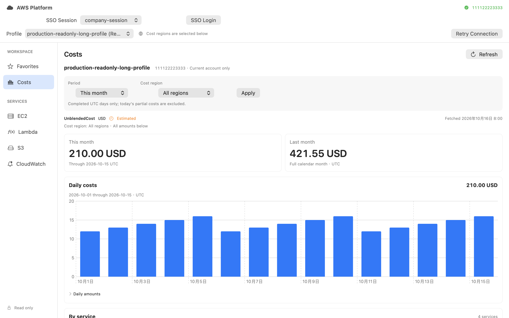

### AWS Health 事件

手动选择并验证 Profile 后，打开侧栏 `Health`，默认「当前账号」，加载该账号所有区域的专属事件，包括尚未开始的计划变更。手动切换「整个组织」后，通过同一 Profile 的权限查询组织事件。公共事件会被过滤；未选 Profile 时不查询。此页隐藏资源 Region 选择器，在其他页面切换资源 Region 不会重查 Health；商业区、中国区和 GovCloud 使用各自的 Health 端点。

组织模式需要管理账号或委派管理员角色、启用全部功能的组织、已启用的 AWS Health 组织视图，以及符合 API 要求的 Support 计划。应用仅执行读取，不自动启用组织访问或修改 Support 计划；组织事件最多保留 90 天。参考 [组织视图前提](https://docs.aws.amazon.com/health/latest/ug/aggregate-events.html) 和 [组织事件接口](https://docs.aws.amazon.com/health/latest/APIReference/API_DescribeEventsForOrganization.html) 。

输入 12 位账号 ID 并应用后，在 AWS 侧筛选该账号事件；留空查询所有账号。选择事件后加载受影响账号 ID，再明确选择其中一个账号，查看对应说明和资源，调用方 Profile 不变。角色需要 `health:DescribeEventsForOrganization`、`health:DescribeAffectedAccountsForOrganization`、`health:DescribeEventDetailsForOrganization` 和 `health:DescribeAffectedEntitiesForOrganization`，组织读取权限使用 `Resource: "*"`。账号列表、说明和资源分别显示失败提示。切换查询范围或应用账号筛选时清空旧结果；切换或清空 Profile 时恢复「当前账号」，取消旧请求并忽略迟到结果。

支持按事件类型、ARN、服务或 Region 搜索，以及状态、类别、服务和事件 Region 的本地筛选。选择事件后显示最新说明、metadata、UTC 时间和受影响资源；说明与资源独立加载，失败分别提示，缺失值明确标记。页面展示 AWS Health 事件及其最新状态，不是每条事件所有更新的历史流水。

列表首次进入时加载，再次进入保留内存结果；使用 `Refresh` 手动重查，`Cancel` 取消等待，不定时轮询。切换或清空 Profile、切换 session、重新登录或重试连接会清空旧结果并使旧请求失效。分页失败不会把部分列表当完整结果，刷新失败时会标记此前列表可能已经过期。

AWS Health API 要求账号具备符合条件的 AWS Support 计划；不满足条件时显示专门提示，仍可在 AWS Health 控制台查看事件。角色需要 `health:DescribeEvents`、`health:DescribeEventDetails` 和 `health:DescribeAffectedEntities`；权限不足时指出对应权限。详见 [Health API 访问要求](https://docs.aws.amazon.com/health/latest/ug/health-api.html) 和 [事件查询 API](https://docs.aws.amazon.com/health/latest/APIReference/API_DescribeEvents.html) 。

以下是使用模拟 Health 数据渲染的组件示例：

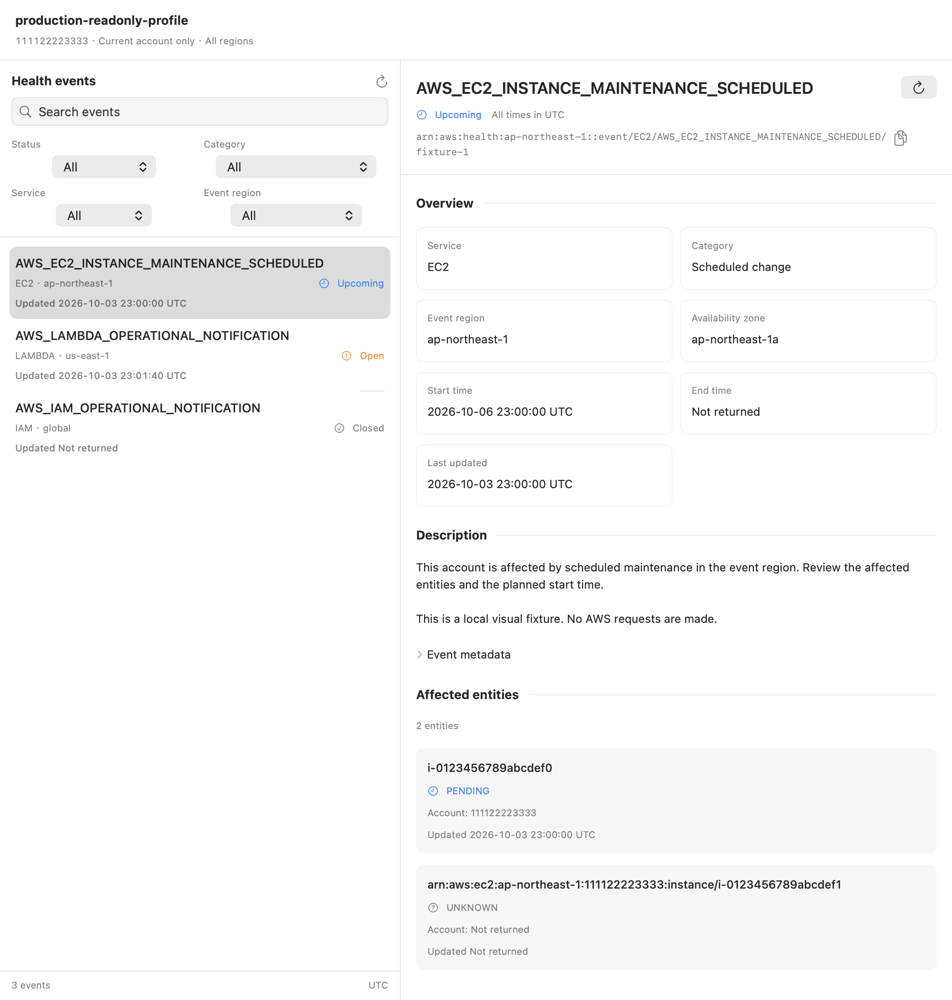

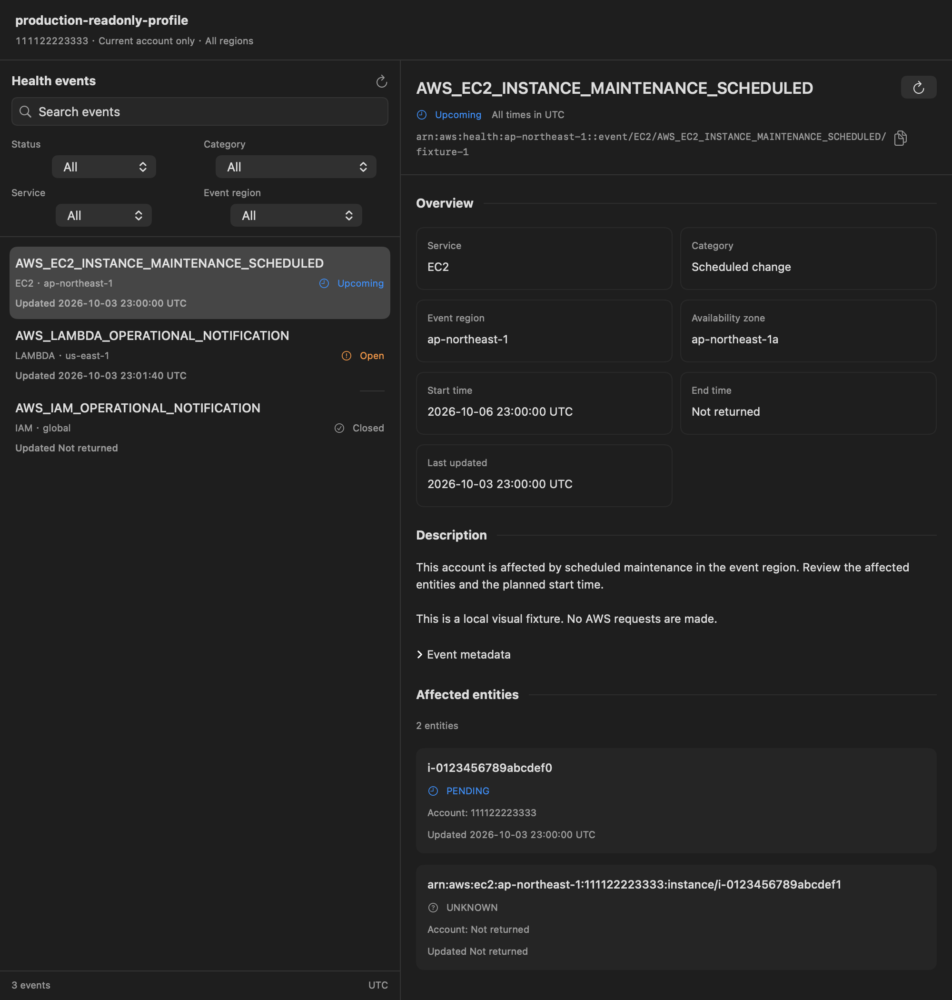

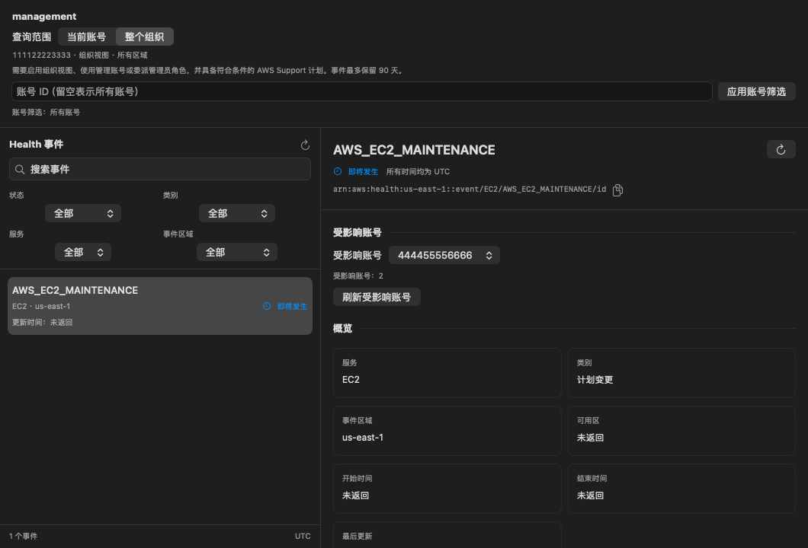

### CloudWatch Alarms

手动选择 Profile 和 Region 后，打开侧栏「CloudWatch → 告警」查看当前账号、当前区域的 Metric Alarm 与 Composite Alarm。首次进入加载列表，支持名称／ARN／指标搜索、状态和类型筛选、手动刷新与取消。返回同一已加载页面不会重复请求，不进行定时轮询；未选 Profile 不查询，切换 Profile、Region 或 session 会清空旧列表和详情。

列表不会自动选中第一个告警。选择告警后可查看：

- `Overview`：状态、原因、更新时间、最近状态切换时间、描述和标签。
- `Configuration`：单指标、维度、Metric Math／Metrics Insights 表达式、阈值与评估设置，或 Composite 的规则和动作抑制设置。
- `Actions`：ALARM、OK、INSUFFICIENT_DATA 对应的目标 ARN 及动作启用状态；同账号、同 Region 的 SNS Topic 可点击 `Open SNS topic` 跳到应用内详情，其他目标保留配置文本。
- `History`：最近 30 天的历史记录，按时间倒序，含状态／配置变更及动作记录，可展开返回的详情数据。

标签和历史仅针对选中的告警读取；各自失败时显示独立错误，基础配置仍可查看，可点击详情右上角的刷新按钮重试。分页失败不会将半份列表或历史当作完整结果。告警可以加入现有本地收藏，按 ARN 保存和定位，仍须先手动选择匹配 Profile 并校验账号；告警删除或无权限时保留收藏并提示。

角色需具备 `cloudwatch:DescribeAlarms`，历史与标签分别需要 `cloudwatch:DescribeAlarmHistory`、`cloudwatch:ListTagsForResource`。为获取 Composite Alarm，前两个权限必须允许 `Resource: "*"`，不能只限定单个告警 ARN。可见范围仍由当前角色权限决定。详见 [DescribeAlarms](https://docs.aws.amazon.com/AmazonCloudWatch/latest/APIReference/API_DescribeAlarms.html) 、[DescribeAlarmHistory](https://docs.aws.amazon.com/AmazonCloudWatch/latest/APIReference/API_DescribeAlarmHistory.html) 和 [ListTagsForResource](https://docs.aws.amazon.com/AmazonCloudWatch/latest/APIReference/API_ListTagsForResource.html) 。

告警页只读取 Metric／Composite Alarm 的配置和历史，不支持 Log Alarm；指标曲线位于 EC2／Lambda 及适用的 RDS 详情 `Metrics` 页。应用不创建、删除、启停告警或改变告警状态，也不向 SNS 发布消息。

以下为模拟告警数据的组件示例：

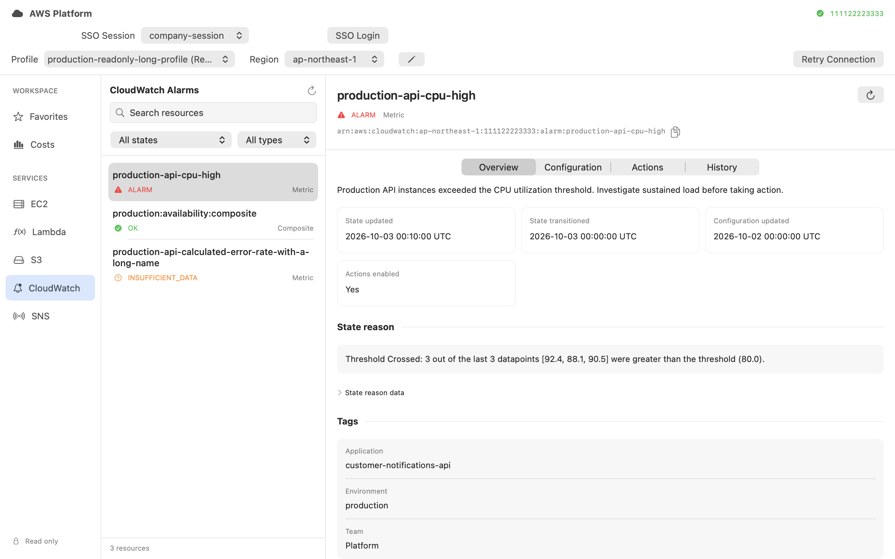

### CloudWatch 日志

打开「CloudWatch → 日志」，浏览所选 Profile／账号／Region 的日志组，不包含 linked account 日志组。选择日志组后读取日志流及可用元数据，包括保留时间、存储字节数、日志类别和 KMS Key。选择全部或单个日志流、最近 1／6／24 小时，按需输入 AWS filter pattern，再点击「搜索」。使用普通 `FilterLogEvents`，不调用 Logs Insights 或 Live Tail，保留 AWS 数据遮罩。

每次手动请求最多 500 条事件，点击「加载更多」继续；未读完时标记不完整，已加载事件按时间倒序展示。最多展示 5,000 条事件或 4 MiB 的 UTF-8 正文，单条消息预览最多 2,000 个字符；达到上限时缩小时间范围或增加过滤条件。更改日志流／时间范围／过滤条件会清空旧搜索，切换范围或日志组使旧请求失效。结果只留在内存，不自动搜索或轮询。

需要 `logs:DescribeLogGroups`、`logs:DescribeLogStreams` 和 `logs:FilterLogEvents`。此入口不创建日志组、启用日志导出或修改保留时间；既有日志采集与存储另行计费，普通读取的计费边界见 [AWS 查询费用说明](docs/aws-query-costs.md) 。

### SNS Topics

手动选择并验证 Profile 后，打开侧栏 `SNS` 查看当前账号、当前 Region 的 Topic。支持名称／ARN 搜索、Standard／FIFO 筛选、手动刷新与取消；首次进入才加载列表，不定时轮询，也不自动选中第一项。未选 Profile 不查询，切换 Profile、Region 或 session 会清空旧数据。可将 Topic 加入本地收藏，按 ARN 定位，沿用手动选择 Profile 和账号校验规则。

选择 Topic 后，属性、标签和订阅分别加载，某一项失败只影响对应区域：

- `Overview`：Topic 身份、显示名、Owner、订阅计数和标签。
- `Configuration`：AWS 返回的加密、FIFO、追踪等配置，以及可展开的访问／投递／归档策略；缺失字段明确显示未返回，不推断为关闭或零。
- `Subscriptions`：订阅协议、状态、Owner、ARN 和 Endpoint。区分 Confirmed、Pending confirmation、Deleted 和 Unknown；合法跨账号订阅保留 Owner 信息，不切换或查询订阅者账号。

Endpoint 默认隐藏，手动显示后可复制，切换 Topic 后重新隐藏。标签、属性和订阅只保留在当前窗口内存中，不写入收藏；分页失败不会展示半份列表或订阅结果。详情右上角的刷新按钮重试三组详情，切换页签不重新请求。

需要 `sns:ListTopics`（`Resource: "*"`），以及对应 Topic 的 `sns:GetTopicAttributes`、`sns:ListTagsForResource` 和 `sns:ListSubscriptionsByTopic` 权限。Topic 属性可能因权限返回不同字段；列表按当前 Profile 账号查询，不自动列出其他账号授权的 Topic。参考 [SNS 权限表](https://docs.aws.amazon.com/service-authorization/latest/reference/list_sns.html) 、[Topic 属性](https://docs.aws.amazon.com/sns/latest/api/API_GetTopicAttributes.html) 和 [Topic 订阅](https://docs.aws.amazon.com/sns/latest/api/API_ListSubscriptionsByTopic.html) 。

此模块不发布消息，不创建／删除 Topic，不订阅／退订／确认订阅，也不修改配置。CloudWatch 动作入口只定位当前 Profile 和 Region 的 Topic，不会通过跳转切换账号或区域；目标不存在或访问失败时显示提示。

点击 Topic 详情中的「调用链查看」，弹窗按 **CloudWatch 告警 → 当前 SNS Topic → 订阅目标** 展示配置关系：

- 初次打开时，资源节点只显示名称；点击名称展开配置详情，再点击 `Open alarm` 或 `Open Lambda function` 进入对应服务。节点可独立展开与收起；长的范围说明位于默认收起的 `About this view`。可定位的 Lambda 订阅显示函数名，其他订阅用协议名称标识，不将邮箱、手机号或 URL 放入节点标题。
- 上游按当前 Profile／Region 读取 Metric 和 Composite Alarm，精确匹配 ALARM、OK、INSUFFICIENT_DATA 三类动作；显示动作是否启用及返回的抑制配置。每次打开弹窗会进行一次完整分页检查，可单独刷新；需要 `cloudwatch:DescribeAlarms`，Composite 要求 `Resource: "*"`。无权限或查询失败显示“检查不完整”，不会等同于没有来源。
- 下游复用 Topic 详情已加载的订阅，展开后显示确认状态；若需更新订阅，关闭弹窗后刷新 Topic 详情。原始 Endpoint 仍默认隐藏，手动显示后才可复制；合法 Lambda 节点展开后即可打开函数详情，无需先显示 Endpoint。
- 告警和已确认的 Lambda 订阅可跳到应用内详情；只允许同一已验证 Profile、账号、Region 和分区。跳转不会写入收藏、自动选择 Profile 或切换 Region。跨范围、未确认或尚无详情模块的目标只展示信息。Lambda 别名／版本会保留显示，但打开的是函数详情，不是该别名／版本的专属详情。

这里展示已配置的关联，不代表消息已经发送或投递成功，也不是全部发布来源清单。S3 通知、Lambda 异步目标及程序代码中的 `Publish` 不在当前扫描范围；Topic Policy 不作为发布来源证据。实际 SNS 发布记录需要另行启用和查询 CloudTrail 数据事件，默认事件历史不包含这些记录。参考 [CloudWatch 告警查询](https://docs.aws.amazon.com/AmazonCloudWatch/latest/APIReference/API_DescribeAlarms.html) 和 [SNS CloudTrail 说明](https://docs.aws.amazon.com/sns/latest/dg/logging-using-cloudtrail.html) 。

以下为模拟 SNS 数据的组件示例：

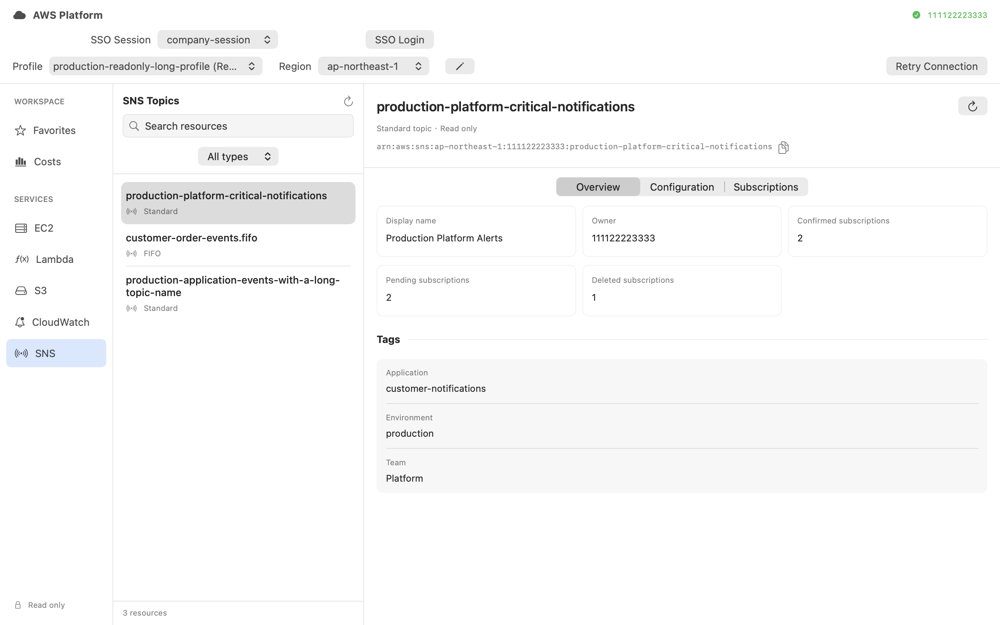

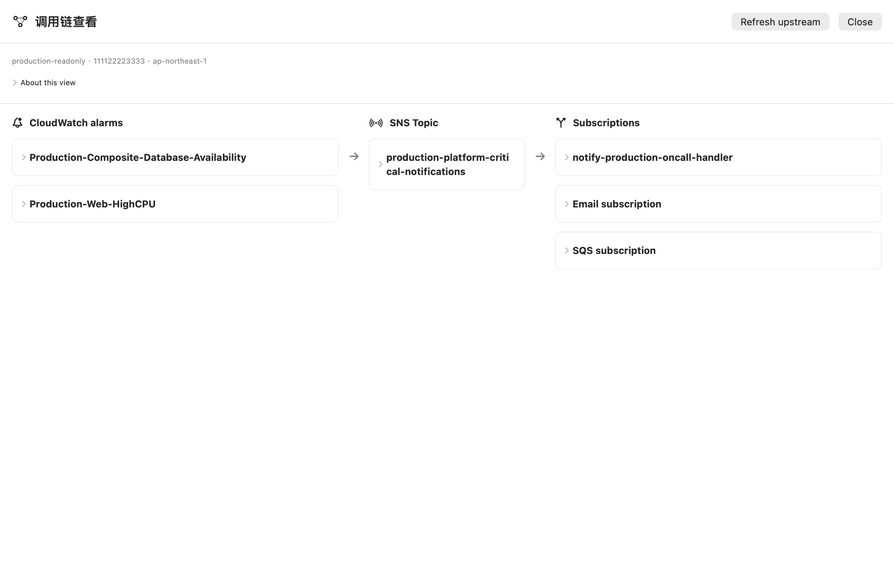

### 资源指标与 Lambda 日志

在 EC2、Lambda 或适用的 RDS 详情中打开 `Metrics`，选择最近 1／6／24 小时，再点击 `Load metrics`。每次按 5 分钟聚合，批量读取适用指标；窗口截至最近一个完整的 5 分钟边界，所有时间显示为 UTC。`Refresh` 手动重新读取，不进行轮询。空样本保留为空，缺失时段断开曲线，部分数据或权限失败分别标注。

| 资源 | 指标 | 聚合与单位 |
| --- | --- | --- |
| EC2 | CPUUtilization | Average，百分比 |
| EC2 | NetworkIn／NetworkOut | Sum，每 5 分钟的字节量 |
| EC2 | StatusCheckFailed | Maximum，状态检查失败值 |
| Lambda | Invocations／Errors／Throttles | Sum，每 5 分钟的次数 |
| Lambda | Duration | Average，毫秒 |
| RDS 实例 | CPUUtilization／DatabaseConnections | Average，百分比／连接数 |
| RDS 实例 | FreeableMemory／ReadLatency／WriteLatency | Average，字节／秒／秒 |
| 非 Aurora 的 RDS 实例 | FreeStorageSpace | Average，字节 |
| Aurora 集群 | VolumeBytesUsed | Average，字节 |
| Aurora 集群 | VolumeReadIOPs／VolumeWriteIOPs | Sum，每 5 分钟的次数 |

Lambda 指标使用函数名维度，包含该函数的版本和别名。指标需要 `cloudwatch:GetMetricData`；缺失数据不推断为零。参考 [EC2 指标](https://docs.aws.amazon.com/AWSEC2/latest/UserGuide/viewing_metrics_with_cloudwatch.html) 、[Lambda 指标](https://docs.aws.amazon.com/lambda/latest/dg/monitoring-metrics-types.html) 和 [GetMetricData](https://docs.aws.amazon.com/AmazonCloudWatch/latest/APIReference/API_GetMetricData.html) 。

Lambda 的 `Logs` 页在函数配置加载成功后可用。选择时间范围，按需输入 CloudWatch filter pattern，再点击 `Search`；过滤条件使用 AWS 语法。结果显示事件时间、日志流、写入时间和可选择的多行正文；长消息先显示预览，可展开全文。修改范围或过滤条件会清空上次搜索，需要重新点击搜索。

日志组优先采用函数的 `LoggingConfig.LogGroup`，未配置时使用 `/aws/lambda/<functionName>`。自定义组先完整枚举日志流，严格匹配当前函数名称，再分批读取；枚举失败时不会降级读取整个共享组。需要 `logs:FilterLogEvents`，自定义日志组还需要 `logs:DescribeLogStreams`；读取函数配置沿用 `lambda:GetFunction`。参考 [Lambda 日志组](https://docs.aws.amazon.com/lambda/latest/dg/monitoring-cloudwatchlogs-loggroups.html) 和 [FilterLogEvents](https://docs.aws.amazon.com/AmazonCloudWatchLogs/latest/APIReference/API_FilterLogEvents.html) 。

点击 `Load more` 继续同一次查询的分页。已加载事件按时间倒序展示；未读完时明确提示部分结果，不将它们称为整个时段的“最新日志”。最多保留 5,000 条事件或 8 MiB 的 UTF-8 正文，超限时不保留超出的整条消息；达到上限或分页保护限制时需缩小范围或增加过滤条件。日志保留 AWS 的数据遮罩，不申请解除遮罩权限。

指标和日志仅在显式加载时调用 API，可能产生 CloudWatch 使用费用。加载期间可点击 `Cancel`；取消停止等待和后续请求，无法撤销已完成的请求。查询凭据、账号与角色来自当前手动选择并验证的 Profile，Region 使用当前资源区域；未选 Profile 不请求。切换资源、Profile、Region 或离开页签会取消等待、清空内存结果，迟到响应不会回填。指标与日志不写入收藏、磁盘或应用诊断日志。

以下为模拟监控数据的组件示例：

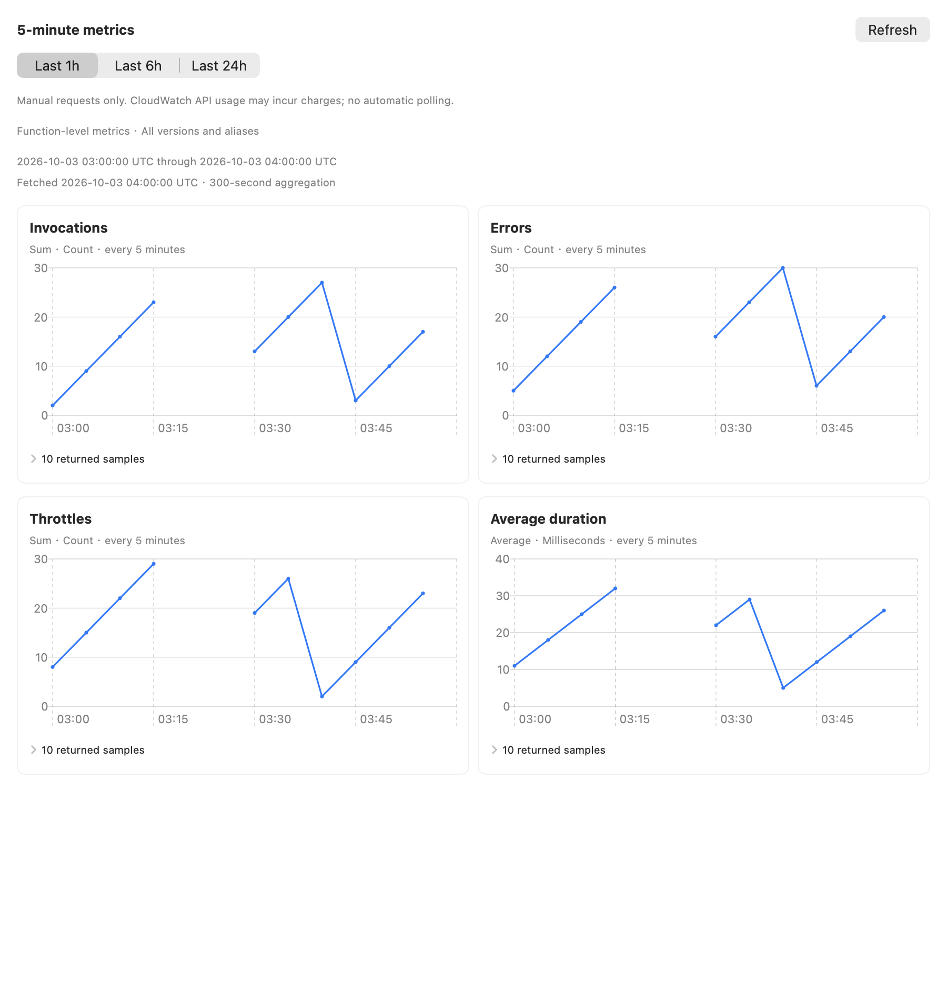

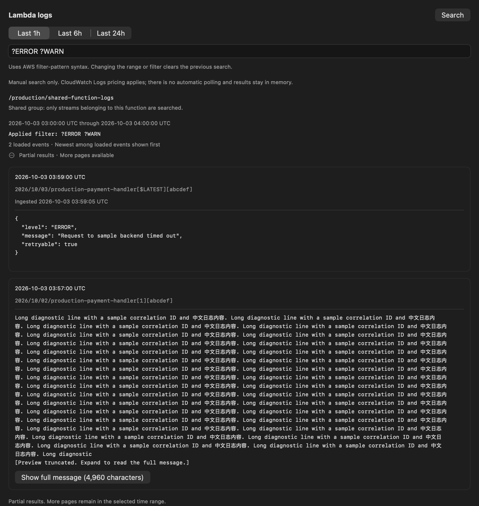

### 应用内 SSO 登录

新凭据和刷新后的凭据在发起服务查询前，会使用同一份凭据通过 STS 核对身份。同一账号和主体的正常续期可以继续使用；账号或角色发生变化时，清空工作区数据并停止待处理任务。请点击 `Retry Connection` 显式重新验证当前 Profile。

1. 在 `SSO Session` 中选择已配置的 session，点击 `SSO Login`。应用后台调用本机 `aws sso login --sso-session <name>`，由 AWS CLI 打开默认浏览器完成授权；不会打开终端窗口，也不需要预先选择 Profile。
2. 登录成功后，Profile 保持 `Select profile`，资源列表与详情保持空白，不发送账号身份验证或资源查询请求。
3. 手动选择关联该 session 的 Profile 后，应用才验证身份并加载该 Profile 对应账号、角色和 Region 的资源。切换 session、重新登录或在 Profile 弹框中点击 `Clear profile selection`，都会清空当前选择和资源展示。

点击 Profile 选择器，可按 Profile 名称、角色或账号 ID 搜索；空格分隔的搜索词需全部匹配。搜索仅筛选所选 session（或 `Other profiles`），不会自动选择 Profile。结果显示配置中的 Profile 名称，下方展示角色和已知账号 ID；只有一个匹配结果时，可按回车手动选择。SSO 账号 ID 来自本地配置，其他 Profile 仅在当前选中并验证身份期间显示账号 ID。应用不查询或缓存 AWS 账户名称。

应用只记住上次选择的具名 session；每次启动都需要重新手动选择 Profile。有效的 AWS CLI 登录缓存可以直接复用，不必每次点击登录。即使一个 session 只有一个 Profile，也不会自动选中；只有 session、尚未配置任何关联 Profile 时，也可以登录。

普通凭据和未使用 `sso_session` 的旧式 SSO Profile 位于 `Other profiles`，仍需手动选择。旧式 SSO 使用终端命令 `aws sso login --profile <name>` 登录，再选择该 Profile 或点击 `Retry Connection`。网络、权限或配置错误显示为连接失败，不会一律标记为未登录。

等待期间可点击 `Cancel Login`；切换 session 或关闭视图也会取消本次等待，Profile 和 Region 在登录期间不可修改。登录最长等待 5 分钟，取消和超时会终止本次启动的 CLI 子进程，不关闭浏览器，也不执行登出或删除已有会话。取消不能撤销浏览器中已经完成的授权。

CLI 必须位于 `/opt/homebrew/bin/aws`、`/usr/local/bin/aws` 或 `/usr/bin/aws`。未安装时应用会给出提示；若浏览器未打开，可取消后在终端登录，再手动选择 Profile。登录和读取凭据使用相同配置路径；登录子进程不继承 `AWS_PROFILE`、`AWS_DEFAULT_PROFILE`，避免终端的预选账号干扰 session 登录。应用不显示、记录或保存登录命令的原始输出，登录缓存由 AWS CLI 管理。

以下为模拟登录成功、尚未选择 Profile 的组件状态：

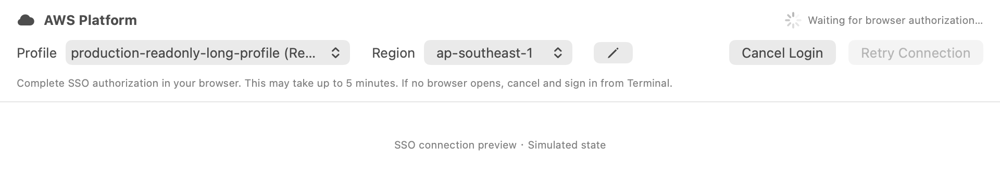

## 项目结构

```
Sources/AWSPlatform/
├── App.swift                    # 应用入口
├── ContentView.swift            # 主视图
├── Models/                      # 数据模型
│   ├── AWSProfile.swift
│   ├── AWSSOSession.swift
│   ├── AWSService.swift
│   ├── CloudWatchAlarm.swift
│   ├── SNSTopic.swift
│   ├── CostModels.swift
│   ├── HealthModels.swift
│   ├── Route53Models.swift
│   ├── ELBModels.swift
│   ├── SecurityGroupModels.swift
│   ├── ResourceRelationModels.swift
│   ├── WorkspaceDestination.swift
│   ├── ResourceFavorite.swift
│   ├── RecentResource.swift
│   ├── EC2Instance.swift
│   ├── LambdaFunction.swift
│   ├── S3Bucket.swift
│   ├── S3ObjectPage.swift
│   └── S3Transfer.swift
├── Services/                    # AWS 服务层
│   ├── AWSServiceProvider.swift
│   ├── AWSS3TransferService.swift
│   ├── S3ObjectListing.swift
│   ├── AWSAlarmService.swift     # CloudWatch 告警、标签和历史读取
│   ├── AWSSNSService.swift       # SNS Topic、配置、标签和订阅读取
│   ├── AWSCostService.swift       # Cost Explorer 读取与完整分页
│   ├── AWSHealthService.swift    # 账号专属 Health 事件、详情和受影响资源
│   ├── AWSRoute53Service.swift   # Hosted Zones、DNS 记录、元数据和标签
│   ├── AWSELBService.swift       # 负载均衡器、目标组、路由配置和目标健康
│   ├── AWSSecurityGroupService.swift
│   ├── AWSResourceRelationshipService.swift
│   ├── AWSCLICredentialProvider.swift # 自定义配置路径的 SSO 凭据桥接
│   └── AWSSSOLoginService.swift  # CLI 登录进程及共享调用配置
├── Utilities/                   # 工具类
│   ├── ConfigReader.swift
│   ├── S3FileDrop.swift
│   ├── S3TransferFiles.swift
│   ├── Route53LoadBalancerMatcher.swift
│   └── UserFacingError.swift
├── ViewModels/                  # 视图模型
│   ├── AlarmViewModel.swift
│   ├── SNSViewModel.swift
│   ├── CostViewModel.swift
│   ├── HealthViewModel.swift
│   ├── Route53ViewModel.swift
│   ├── ELBViewModel.swift
│   ├── SecurityGroupsViewModel.swift
│   ├── ResourceRelationshipsViewModel.swift
│   ├── EC2TargetGroupsViewModel.swift
│   ├── ELBResourceNavigation.swift
│   ├── EC2ViewModel.swift
│   ├── FavoriteNavigation.swift
│   ├── FavoritesViewModel.swift
│   ├── RecentResourcesViewModel.swift
│   ├── LambdaViewModel.swift
│   ├── ProfileViewModel.swift
│   ├── S3ViewModel.swift
│   └── S3TransferViewModel.swift
└── Views/                       # 界面视图
    ├── CloudWatch/
    ├── SNS/
    ├── Cost/
    ├── Health/
    ├── Route53/
    ├── ELB/
    ├── SecurityGroups/
    ├── Relationships/
    ├── EC2/
    ├── Lambda/
    ├── S3/
    ├── FavoritesListView.swift
    ├── RecentResourcesListView.swift
    ├── ProfileBarView.swift
    ├── ServiceSidebarView.swift
    └── SharedViews.swift

Tests/AWSPlatformTests/           # 配置解析和 ViewModel 单元测试
```

## AWS 配置

确保 `~/.aws/config` 文件格式正确：

```ini
[default]
region = us-east-1
output = json

[profile my-profile]
region = ap-northeast-1
output = json
```

AWS CLI 的 `[sso-session ...]` 显示在独立的 `SSO Session` 选择器中，不会混入 Profile；`[services ...]` 等辅助配置节不会显示为可选 Profile。

Profile 列表合并 `config` 和 `credentials` 中的名称，同名时使用 `config` 的区域等配置；仅存在于 `credentials` 的 Profile 使用默认区域 `us-east-1`。应用支持进程环境变量 `AWS_CONFIG_FILE` 和 `AWS_SHARED_CREDENTIALS_FILE`，发现配置和建立 AWS 客户端使用相同的路径。由 Finder 启动的进程不会自动继承终端中临时设置的环境变量；需要自定义路径时，可从设置了这些变量的终端运行 `swift run`。

默认配置路径下的 SSO 使用 Soto 的凭据提供器。自定义 `AWS_CONFIG_FILE` 下的 SSO 使用本机 AWS CLI v2 的 `configure export-credentials`；CLI 需安装在 `/opt/homebrew/bin/aws` 或 `/usr/local/bin/aws`（也支持 `/usr/bin/aws`），并支持该命令。应用只在内存管道中解析凭据，不显示或保存命令输出。应用内登录自动传入相同的配置路径；若在终端登录，必须使用相同的配置路径和 session，完成后手动选择 Profile；已选 Profile 可点击 `Retry Connection`。

支持多个 Profile 共用一个具名 SSO session，例如：

```ini
[profile development]
sso_session = company
sso_account_id = 111122223333
sso_role_name = DeveloperAccess
region = eu-west-1

[profile production]
sso_session = company
sso_account_id = 444455556666
sso_role_name = ReadOnlyAccess
region = ap-southeast-1

[sso-session company]
sso_start_url = https://example.awsapps.com/start
sso_region = us-east-1
sso_registration_scopes = sso:account:access
```

将示例替换为实际配置后，执行 `aws sso login --sso-session company` 即可登录共用的 `company` session；应用中选中 `company` 后，Profile 列表包含 `development` 和 `production`，仍需手动选择其一。在会话有效且具备对应账号／角色权限时，两个 Profile 可复用登录状态。每个 Profile 独立决定账号、角色和资源 Region；`sso_region` 是身份中心区域。标准格式中一个 Profile 引用一个 session，不同 session 需要分别登录；应用不会自动枚举或创建其他账号的 Profile。配置方式见 [AWS CLI SSO 官方文档](https://docs.aws.amazon.com/cli/latest/userguide/cli-configure-sso.html) 。

Region 列表包含 SDK 已知的常用区域以及配置中的区域。已知区域同时显示本地化地点和原始代码，例如 `新加坡 · ap-southeast-1`；未知代码按原文显示。也可以通过 Region 旁的编辑按钮输入其他区域代码。区域是否启用、所属分区和服务权限仍由 AWS 决定。

Lambda 列表通过 `GetFunction` 补充状态和标签，最多同时读取 4 个函数。部分函数权限不足或读取失败时，列表仍保留，显示提示；状态筛选不包含状态未知的函数。相关权限至少包括 `lambda:ListFunctions` 和用于补充信息的 `lambda:GetFunction`。

手动加载 Lambda 源码时，应用将 ZIP 流式下载到私有系统临时目录，在内存中读取内容，并在成功、失败或取消后尝试删除临时目录。ZIP 条目不会按其路径解压到文件系统；查看源码仍会在本机产生临时 ZIP 文件。

源码预览上限为：下载 50 MiB、展开内容 250 MiB、文件及目录共 10,000 项、累计文本预览 10 MiB。单个文本仍保留 200,000 字节的预览限制；二进制和较大的文件只列出名称。隐藏条目不展示，但仍计入部署包限制。下载最多等待 60 秒，ZIP 处理限时 30 秒；加载时可点击「取消」。切换函数或清空／切换 Profile 后，旧请求失效。

预览支持使用 Store 或 Deflate 的普通未加密单卷 ZIP。ZIP64、符号链接、特殊文件、替代路径／链接元数据、不安全或重复路径、超过 1,024 字节或 32 层的路径，以及大小或 CRC 不一致的内容会被拒绝并显示错误。这些是本地预览限制，不是 AWS 部署配额。容器镜像函数继续展示镜像信息，不读取 ZIP 源码。

参考：[AWS CLI 凭据导出](https://docs.aws.amazon.com/cli/latest/reference/configure/export-credentials.html) 、[AWS CLI 环境变量](https://docs.aws.amazon.com/cli/latest/userguide/cli-configure-envvars.html) 、[Lambda 列表接口字段范围](https://docs.aws.amazon.com/lambda/latest/api/API_ListFunctions.html) 。

## 项目进度

当前阶段、验证记录和待办以 [`ROADMAP.md`](ROADMAP.md) 为准。

## License

本项目原创代码采用 [MIT License](LICENSE)。第三方依赖保留各自许可，版本及上游许可证见 [THIRD_PARTY_NOTICES.md](THIRD_PARTY_NOTICES.md)。
